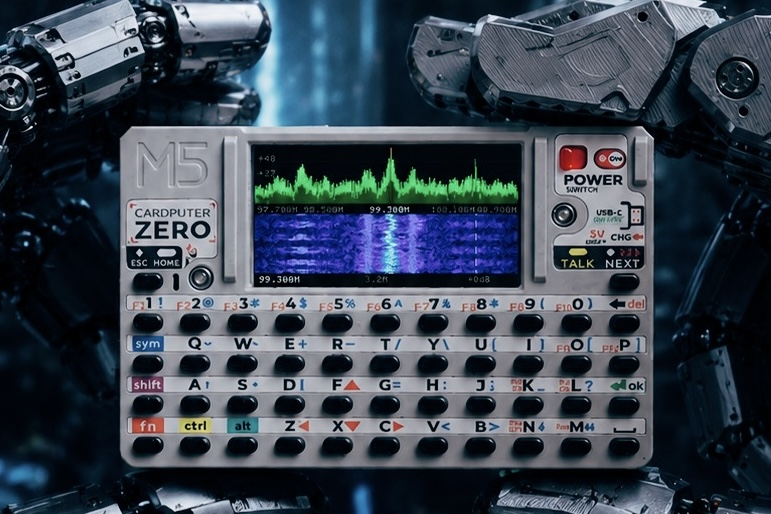

# zeroSDR

[](https://www.gnu.org/licenses/gpl-3.0)
[]()

**English** | [简体中文](README.zh-CN.md)

zeroSDR is an open source SDR receiver for Linux-based small-screen embedded
systems. It renders the spectrum and waterfall straight into the framebuffer
and demodulates FM / NFM / AM / USB / LSB audio through ALSA.



> **Press `H` on the SDR page to show the on-screen key list.**
> Press `→` there to switch to the settings tab (FM de-emphasis, audio AGC,
> FFT size, sample rate). Press `H` again to close.

## Features

- Real-time spectrum and waterfall on a 320x170 framebuffer
- FM / NFM / AM / USB / LSB demodulation with squelch, audio AGC and
  FM de-emphasis (50/75 µs)
- Hardware AGC and manual gain, display zoom, FFT size and sample-rate presets
- On-screen key reference and settings panel (`H`)
- ADSB aircraft page (readsb) with radar/PFD view
- Runs as the normal desktop user (no root) thanks to the librtlsdr udev rule
- Optimized for Raspberry Pi Zero 2W / Pi 5 and the M5Stack Cardputer Zero

## Hardware

- Raspberry Pi 5 / Pi Zero 2W / M5Stack Cardputer Zero (CM0, aarch64)
- RTL-SDR dongle (tested: RTL-SDR Blog V4, RTL2832U)
- 320x170 framebuffer display (`/dev/fb0`, on Cardputer Zero also `/dev/fb_lcd`)
- Latest rtl-sdr drivers (critical for correct tuning)

## Quick start (desktop / Raspberry Pi)

```bash
sudo apt-get update
sudo apt-get install -y build-essential cmake librtlsdr-dev libasound2-dev libfreetype-dev

cmake -S . -B build -DCMAKE_BUILD_TYPE=Release
cmake --build build -j"$(nproc)"

./build/zerosdr                    # defaults: 100 MHz, 1.024 MS/s, auto gain
./build/zerosdr -f 99300000        # 99.3 MHz FM
./build/zerosdr -s 2048000 -g 20   # custom sample rate and gain
```

`Release` build is required on the CM0: FFT + demodulation + resampling all run
in real time on four small cores.

## Manual deployment on Cardputer Zero

APPLaunch launches apps as the desktop user `pi` and resolves `Exec` / `Icon`
relative to `/usr/share/APPLaunch`. The final layout is:

```text
/usr/share/APPLaunch/
├── applications/zerosdr.desktop
├── bin/zerosdr                 # binary
├── bin/run-zerosdr             # wrapper: display / keyboard / audio setup
└── share/images/zerosdr.png    # icon
```

### 1. Build (on the device, recommended)

```bash
sudo apt-get install -y build-essential cmake librtlsdr-dev libasound2-dev libfreetype-dev
cd ~/zerosdr
cmake -S . -B build -DCMAKE_BUILD_TYPE=Release
cmake --build build -j"$(nproc)"
file build/zerosdr        # should report: ARM aarch64
```

### 2. Install the binary

```bash
sudo install -d /usr/share/APPLaunch/bin
sudo install -m 755 build/zerosdr /usr/share/APPLaunch/bin/zerosdr
```

### 3. Install the launcher wrapper

APPLaunch's `Terminal=false` mode does not run a shell, so `-d /dev/fb_lcd`
cannot be put in `Exec`. The wrapper also reuses the user's PipeWire session
and keeps the ES8389 DAC at -6 dB (0 dB causes dropouts on this hardware).

```bash
sudo tee /usr/share/APPLaunch/bin/run-zerosdr >/dev/null <<'EOF'
#!/bin/sh
set -eu

# APPLaunch starts apps in the user session; reuse its PipeWire runtime.
if [ -z "${XDG_RUNTIME_DIR:-}" ]; then
    for d in /run/user/*; do
        if [ -S "$d/pipewire-0" ]; then
            XDG_RUNTIME_DIR="$d"
            break
        fi
    done
fi
if [ -n "${XDG_RUNTIME_DIR:-}" ]; then
    export XDG_RUNTIME_DIR
    export PIPEWIRE_RUNTIME_DIR="$XDG_RUNTIME_DIR"
fi

# 128-frame quantum causes periodic xruns on the CM0.
if command -v pw-metadata >/dev/null 2>&1; then
    pw-metadata -n settings 0 clock.force-quantum 1024 >/dev/null 2>&1 || true
fi

# ES8389 speaker amp drops out at 0 dB; 179 = -6 dB.
amixer -c 1 cset name='DACL Playback Volume' 179 >/dev/null 2>&1 || true
amixer -c 1 cset name='DACR Playback Volume' 179 >/dev/null 2>&1 || true

# LCD framebuffer.
if [ -n "${LV_LINUX_FBDEV_DEVICE:-}" ]; then
    FB="$LV_LINUX_FBDEV_DEVICE"
elif [ -e /dev/fb_lcd ]; then
    FB=/dev/fb_lcd
else
    FB=/dev/fb0
fi

# TCA8418 keyboard.
KBD=/dev/input/by-path/platform-3f804000.i2c-event

set -- -d "$FB" "$@"
if [ -e "$KBD" ]; then
    set -- "$@" -k "$KBD"
fi

exec /usr/share/APPLaunch/bin/zerosdr "$@"
EOF
sudo chmod 755 /usr/share/APPLaunch/bin/run-zerosdr
```

### 4. Install the desktop entry

```bash
sudo install -d /usr/share/APPLaunch/applications
sudo tee /usr/share/APPLaunch/applications/zerosdr.desktop >/dev/null <<'EOF'
[Desktop Entry]
Name=zeroSDR
Comment=Lightweight SDR receiver
Exec=bin/run-zerosdr
Terminal=false
Icon=share/images/zerosdr.png
Type=Application
EOF
```

### 5. Install the icon

```bash
sudo install -d /usr/share/APPLaunch/share/images
sudo install -m 644 share/images/zerosdr.png \
    /usr/share/APPLaunch/share/images/zerosdr.png
```

### 6. Permissions (no root needed)

librtlsdr ships `/lib/udev/rules.d/60-librtlsdr0.rules`, which sets the dongle
to `root:plugdev 0660`. Make sure `pi` is in `plugdev` (and in `video` /
`audio` / `input`) and re-plug the dongle:

```bash
groups pi
ls -l /dev/bus/usb/*/*        # the RTL-SDR node should be root plugdev
lsusb | grep -i 0bda
```

### 7. Restart APPLaunch and verify

```bash
export XDG_RUNTIME_DIR=/run/user/1000
export DBUS_SESSION_BUS_ADDRESS=unix:path=/run/user/1000/bus
systemctl --user restart APPLaunch.service
```

Open **zeroSDR** from the launcher, then check:

1. the spectrum/waterfall is moving,
2. **press `H` — the key list appears; press `→` for settings**,
3. audio is audible (tune to a known station),
4. `Tab` switches to the ADSB page, `Q`/`Esc` returns to the launcher.

Logs:

```bash
journalctl --user -u APPLaunch.service -f
```

Expected lines:

```text
Framebuffer initialized: 320x170
Keyboard map: Cardputer Zero (tca8418c)
RTL-SDR device initialized
Audio output initialized: 48000 Hz, 1 channel(s)
```

### Uninstall

```bash
sudo rm -f /usr/share/APPLaunch/bin/zerosdr \
           /usr/share/APPLaunch/bin/run-zerosdr \
           /usr/share/APPLaunch/applications/zerosdr.desktop \
           /usr/share/APPLaunch/share/images/zerosdr.png
systemctl --user restart APPLaunch.service
```

### `.deb` alternative

```bash
dpkg-buildpackage -us -uc -b
sudo dpkg -i ../zerosdr_*.deb
```

The package installs `usr/bin/zerosdr` plus the APPLaunch entry, binary and
icon under `/usr/share/APPLaunch/`. It deliberately does **not** install a
system `/usr/share/applications` entry (the AppStore path policy only allows
`usr/share/<package>/**` and `usr/share/APPLaunch/**`), and no `-dbgsym`
package is generated.

For a much more detailed Cardputer Zero walkthrough (audio, ADSB/readsb,
package pitfalls, recovery steps) see [cardputerzero.md](cardputerzero.md).

## Keyboard controls

### Press `H` first

The SDR page has a built-in reference:

```text
H          open / close the overlay
← / →      switch between the key list and the settings tab
↑ / ↓      select a setting
Enter      change the selected setting
```

### Cardputer Zero keymap

The TCA8418 keyboard is detected automatically (`tca8418c`). Plain
`F`/`Z`/`X`/`C` act as arrow keys, `Fn` combinations emit the standard special
codes, and plain letters are used for the SDR controls.

| Key | Action |
|-----|--------|
| `Z` / `←` | Tune down |
| `C` / `→` | Tune up |
| `F` / `↑` | Gain up |
| `X` / `↓` | Gain down |
| `Shift`+`Z`/`C` | Coarse tune (step × 10) |
| `Fn`+`L` (PgUp) | Tune +1 MHz |
| `Fn`+`M` (PgDn) | Tune -1 MHz |
| `0-9` `.` | Direct frequency input (MHz) |
| `Enter` | Apply frequency |
| `Backspace` | Delete last digit |
| `Esc` | Cancel input |
| `D` | Cycle demodulation mode (FM/NFM/AM/USB/LSB) |
| `B` / `Fn`+`B` | Cycle demodulation bandwidth |
| `Fn`+`D` | Volume up |
| `Fn`+`S` | Volume down |
| `S` | Squelch (+5%; hold >0.5 s = 10%, >1.5 s = 25%) |
| `T` | Cycle tuning step (Auto/100/1k/5k/10k/100k/1M) |
| `Space` / `Fn`+`A` | Audio on/off |
| `G` | Hardware AGC on/off |
| `M` | Display mode (both/spectrum/waterfall) |
| `Y` | Display zoom (only spans the sample rate can fill) |
| `Fn`+`J` (PrintScreen) | Screenshot (`/tmp/zerosdr_*.png`) |
| `H` | Key list, then `→` for settings |
| `Tab` | Switch page (SDR ↔ ADSB) |
| `Q` / `Esc` | Quit |

### PC keyboard

| Key | Action |
|-----|--------|
| `←` `→` | Tune (Shift = coarse) |
| `↑` `↓` | Gain |
| `PgUp` `PgDn` | ±1 MHz |
| `D` | Demodulation mode |
| `B` / `Shift+B` | Demodulation bandwidth |
| `Space` | Audio on/off |
| `V` / `C` | Volume up / down |
| `S` | Squelch |
| `T` | Tuning step |
| `M` | Display mode |
| `Shift+Z` | Display zoom |
| `Shift+R` | FFT size |
| `Shift+S` | Screenshot |
| `H` | Key list / settings |
| `Tab` | Switch page |
| `Q` / `Esc` | Quit |

## Settings (`H` → `→`)

Rarely changed options live in the settings tab instead of hotkeys:

| Item | Values | Default |
|------|--------|---------|
| FM de-emphasis | 50 µs (CN/EU/Asia) / 75 µs (US) | 50 µs |
| Audio AGC | On / Off | On |
| FFT size | 256 / 512 / 1024 / 2048 | 512 |
| Sample rate | 1.024 / 1.2 / 1.8 / 2.048 / 2.4 MHz | 1.024 MHz |

Changing the sample rate resets the display span to the widest level that fits
the new band (1.2 M → 1.0 M, 2.048 M → 2.0 M), so `Y` never appears to do
nothing because the stored span was wider than the captured bandwidth.

Settings are stored in:

```text
~/.config/zerosdr/sdr_settings.json
```

```json
{
  "deemphasis_us": 50,
  "audio_agc": true,
  "fft_size": 512,
  "sample_rate": 1024000
}
```

## Demodulation bandwidth presets

**FM (broadcast)**: 200 / 250 / **300** / 400 / 500 kHz
**NFM**: 6.25 / **12.5** / 25 kHz
**AM**: 5 / **10** / 15 kHz
**SSB (USB/LSB)**: 2.4 / 2.7 / 3.0 kHz

## Display zoom levels

`Y` cycles 50k / 100k / 200k / 500k / 1M / 2M / 2.8M / 3.2M, limited to what
the current sample rate can fill.

## ADSB page

`Tab` switches between the SDR page and the ADSB aircraft list. In the list:

| Key | Action |
|-----|--------|
| `↑` / `↓` | Select aircraft |
| `←` / `→` | Move 5 rows (`PgUp`/`PgDn` also work) |
| `Enter` | Cycle views: list → detail → radar → list |
| `R` | Jump straight to the radar view (needs an observer position) |
| `H` | Key list + settings (latitude, longitude, clear position) |
| `L` | Position editor |
| `G` / `+` / `-` | Radar gain mode / gain |
| `Tab` | Back to the SDR page |

The radar's left panel lists `ICAO` / altitude / distance, with the selected
aircraft's callsign shown in large text on a dim strip that spans the full
width of the panel. The callsign and the ADSB status/detail text are rendered
with an anti-aliased TrueType font.

ADSB decoding is done by a `readsb` build with the RTL-SDR backend that ships
inside this package (`/usr/lib/zerosdr/readsb`); no separate decoder install is
needed. A system `/usr/bin/readsb` is used as a fallback if present.

`H` opens a full-screen overlay with two tabs: the key list and a settings tab
where you can view/edit the observer latitude and longitude (opening the usual
position editor) or clear the stored position. `←`/`→` switch tabs, `↑`/`↓`
select, `Enter` edits, `H` closes.

Audio feedback:

- a short beep when the list selection moves,
- one sonar ping per radar revolution (6 s at 60°/s),
- a quiet tick every 90° of the sweep,
- a two-tone chime when a new aircraft appears (at most once every 3 s).

## Command line options

```text
Usage: zerosdr [options]
  -f <freq>     Center frequency in Hz (default: 100000000)
  -s <rate>     Sample rate in Hz (default: 1024000)
  -g <gain>     Gain in dB (default: auto)
  -d <device>   Framebuffer device (default: /dev/fb0)
  -k <device>   Keyboard input device (default: auto-detect)
  -h            Show help
```

## Troubleshooting

### Waterfall looks empty but audio is clear

Broadcast FM tolerates being slightly off frequency: a station 100 kHz away
from the displayed centre still demodulates cleanly, while its peak sits just
right/left of the red centre line. Tune exactly onto the peak (the `T` step is
100 kHz in FM AUTO mode) if you want it centred.

The narrow bright line exactly at the centre is the RTL-SDR DC / LO leakage,
not a station. A real broadcast station is a ~200 kHz wide plateau.

### Loud noise on empty frequencies

With squelch off (`SQ:OFF`) and audio AGC on, demodulated noise is amplified to
almost full scale. Press `S` to raise the squelch; the noise gates out and only
real signals come through.

### RTL-SDR not detected / permission denied

```bash
lsusb | grep -i 0bda
ls -l /dev/bus/usb/*/*      # expect root:plugdev 0660
groups pi                   # expect plugdev, video, audio, input
```

Re-plug the dongle after installing/updating `librtlsdr0`.

### Device busy

```bash
sudo pkill readsb
sudo pkill -f rtl_
```

### No audio

```bash
aplay -L | head             # "default" should point at PipeWire
amixer -c 1 sget Speaker
```

The wrapper sets `DACL/DACR Playback Volume` to 179 (-6 dB); 0 dB causes the
ES8389 amplifier to drop out.

### Frequency offset

```bash
rtl_test -p                 # PPM measurement
```

A few ppm is normal (e.g. -27 ppm ≈ 2.7 kHz at 100 MHz). Large offsets usually
mean an old rtl-sdr driver.

### Blank screen / wrong display

```bash
cat /proc/fb
ls -l /dev/fb*
```

Run manually to isolate APPLaunch:

```bash
/usr/share/APPLaunch/bin/zerosdr -d /dev/fb_lcd \
    -k /dev/input/by-path/platform-3f804000.i2c-event
```

## Cross-compilation

```bash
sudo apt-get install -y gcc-aarch64-linux-gnu g++-aarch64-linux-gnu libfreetype-dev

cmake -S . -B build-aarch64 -DCMAKE_BUILD_TYPE=Release \
  -DCMAKE_SYSTEM_NAME=Linux \
  -DCMAKE_SYSTEM_PROCESSOR=aarch64 \
  -DCMAKE_C_COMPILER=aarch64-linux-gnu-gcc \
  -DCMAKE_CXX_COMPILER=aarch64-linux-gnu-g++
cmake --build build-aarch64 -j"$(nproc)"

scp build-aarch64/zerosdr pi@<cardputer-ip>:/tmp/
```

## License

This project is licensed under the GNU General Public License v3.0 — see the
[LICENSE](LICENSE) file for details.

## Acknowledgments

- Built with [rtl-sdr](https://github.com/osmocom/rtl-sdr)
- Designed for M5Stack Cardputer Zero
