# ZeroSDR

[](https://www.gnu.org/licenses/gpl-3.0)
[]()
[](https://ko-fi.com/nu11being)

**English** | [简体中文](README.zh-CN.md)

ZeroSDR is an open source SDR receiver for Linux-based small-screen embedded
systems. It renders the spectrum and waterfall straight into the framebuffer,
demodulates FM / NFM / AM / USB / LSB audio through ALSA, and adds ADSB
aircraft, AIS vessels, ACARS messages and APRS stations plus an RFI survey
page.

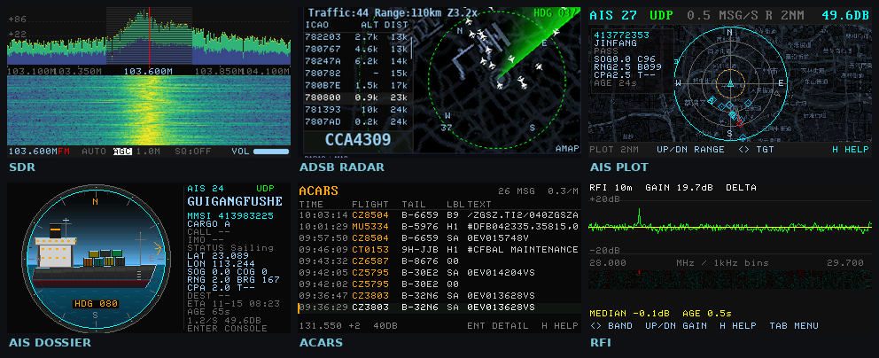

*SDR and wideband spectrum, ADSB radar / PFD / settings, AIS plot and
dossier, ACARS messages, APRS stations and the RFI survey.*

> **Press `H` on the SDR page to show the on-screen key list.**
> Press `→` there to switch to the settings tab (FM de-emphasis, audio AGC,
> FFT size, sample rate). Press `H` again to close.

| | |
|:---:|:---:|
|  |  |
| Wideband spectrum page: 460–480 MHz sweep with max hold | SDR page: 103.6 MHz FM with spectrum and waterfall |

## Features

- Real-time spectrum and waterfall on a 320x170 framebuffer
- FM / NFM / AM / USB / LSB demodulation with squelch, audio AGC and
  FM de-emphasis (50/75 µs)
- Hardware AGC / manual gain, display zoom, FFT size and sample-rate presets
- On-screen key reference and settings (`H`); `Tab` page menu with a RADAR
  shortcut
- Wideband swept spectrum page: custom start/stop, pan/zoom, max hold and six
  colour themes
- ADSB list sorted by distance; holding `F` jumps back to the top
- ADSB radar with Esri / AMap / OSM map backgrounds (dark AMap/OSM), gyro
  heading-up, `R` / `T` zoom and a red tech theme (`M`)
- ADSB detail PFD: round or rounded-square attitude ball (`M`), pitch ladder,
  bank pointer, speed/altitude tapes and an audio variometer
- AIS vessel tracking: native dual-channel decoder, list / plot / dossier /
  console views, map and CPA display, and a standard NMEA UDP feed
- ACARS aircraft messages: message list and wrapped detail view, payload tags
  and position/route decoding, with airport names resolved from a bundled
  OurAirports extract; the bundled decoder runs as a separate process and the
  channels are configurable per region (131.550 / 131.725 / 131.825 by default)
- APRS station tracking: native receive-only 1200 baud AFSK / AX.25 decoder,
  list / map / detail / console views, Mic-E and compressed positions,
  weather and messages on 144.640 MHz (configurable)
- RFI survey: compare HF band noise with your equipment switched on and off
  (10m / 20m / 40m / 80m)
- Global `Fn`+`P` screenshot on every page
- System volume from every page (`Fn`+`D` / `Fn`+`S`)
- Runs as the normal desktop user (no root) via the udev rules shipped with the package
- Optimized for Raspberry Pi Zero 2W / Pi 5 and the M5Stack Cardputer Zero

## RFI equipment comparison (experimental)

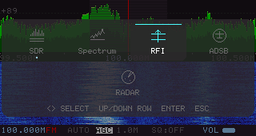
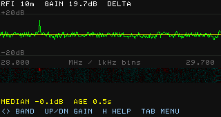

Select **RFI** from the `Tab` page menu. The receive survey presets are 10m
(28.0–29.7 MHz), 20m (14.0–14.35 MHz), 40m (7.0–7.3 MHz), and 80m
(3.5–4.0 MHz). These spans do not define regional transmit privileges.
HF reception requires a suitable receiver and driver; the prototype was tuned
with an RTL-SDR Blog V4.

With the suspected equipment **on**, select a band with Left/Right and set
manual gain with Up/Down. Press **Enter** (or B) and leave the equipment on
until all eight baseline sweeps finish. Then switch the equipment off.
The green spectrum is live; the yellow spectrum is the frozen reference.
The waterfall shows changes: **cyan means less received power**, red means
more. Each row represents a completed sweep, rather than a fixed time interval.
**Space** switches the graph to a fixed ±20 dB difference scale. The median
readout is the typical per-bin change across the band, not a calibrated noise
figure or an identification of the interference source. Strong individual
signals can be inspected on the graph. Levels are relative, not calibrated dBm.

Band/gain changes, retry, and leaving/re-entering RFI clear the reference.
`R` retries/reset acquisition; `H` opens help; `Fn+P` saves a screenshot.
Keep the antenna/probe and its position unchanged during a comparison.
No automatic equipment control or source classification is performed.

Measurement checks can be run without SDR hardware:

```sh
c++ -std=c++17 -Iinclude tests/rfi_measurement_test.cpp src/fft_processor.cpp -o /tmp/rfi-test
/tmp/rfi-test
```

## Hardware


*Cardputer Zero (M5Stack CM0) running ZeroSDR.*

- Raspberry Pi 5 / Pi Zero 2W / M5Stack Cardputer Zero (CM0, aarch64)
- RTL-SDR dongle (tested: RTL-SDR Blog V4, RTL2832U)
- 320x170 framebuffer display (`/dev/fb0`, on Cardputer Zero also `/dev/fb_lcd`)
- Latest rtl-sdr drivers (critical for correct tuning)
- Optional: [3D-printed RTL-SDR V4 mount](#rtl-sdr-v4-mount)

## RTL-SDR V4 mount

A 3D-printed mount designed by the ZeroSDR author for the RTL-SDR Blog V4
dongle. It clamps the dongle to the back of the Cardputer Zero, so the receiver
and the antenna connector travel as one unit; a short USB-C cable loops back to
the device.

<a href="hardware/rtl-sdr-v4-mount/CardputerZero_RTLSDR_V4_mount.jpg"></a>

Printable STL:
[CardputerZero_RTLSDR_V4_mount.stl](hardware/rtl-sdr-v4-mount/CardputerZero_RTLSDR_V4_mount.stl).
It needs two M2 x 6 mm screws (not included) and is released under
[CC0 1.0](hardware/rtl-sdr-v4-mount/LICENSE). Sizing and print notes are in the
[mount directory](hardware/rtl-sdr-v4-mount/).

## Quick start (desktop / Raspberry Pi)

```bash
sudo apt-get update
sudo apt-get install -y build-essential cmake librtlsdr-dev libasound2-dev libpulse-dev libfreetype-dev nlohmann-json3-dev curl

cmake -S . -B build -DCMAKE_BUILD_TYPE=Release
cmake --build build -j"$(nproc)"

./build/zerosdr                    # defaults: 100 MHz, 1.024 MS/s, auto gain
./build/zerosdr -f 99300000        # 99.3 MHz FM
./build/zerosdr -s 2048000 -g 20   # custom sample rate and gain
```

`Release` build is required on the CM0: FFT + demodulation + resampling all run
in real time on four small cores.

## Install on Cardputer Zero

ZeroSDR is in the Cardputer Zero AppStore: open the store, find **ZeroSDR** and
install it. On the device shell the same package is:

```bash
sudo apt update && sudo apt install zerosdr
```

It installs the binary, the APPLaunch entry and icon, and the `readsb` decoder
with the RTL-SDR backend, so nothing else needs to be set up.

## Manual deployment on Cardputer Zero

The AppStore / `.deb` package is the recommended path. For a manual install,
build with `Release`, then copy the binary, wrapper and launcher files:

```bash
cmake -S . -B build -DCMAKE_BUILD_TYPE=Release
cmake --build build -j"$(nproc)"
sudo install -Dm755 build/zerosdr /usr/share/APPLaunch/bin/zerosdr
sudo install -Dm755 share/bin/run-zerosdr /usr/share/APPLaunch/bin/run-zerosdr
sudo install -Dm644 share/APPLaunch/applications/zerosdr.desktop \
    /usr/share/APPLaunch/applications/zerosdr.desktop
sudo install -Dm644 share/images/zerosdr.png \
    /usr/share/APPLaunch/share/images/zerosdr.png
systemctl --user restart APPLaunch.service
```

`run-zerosdr` selects the LCD framebuffer and keyboard, reuses APPLaunch's
PipeWire session and keeps the ES8389 DAC at -6 dB. Runtime needs only the
standard librtlsdr udev rule (no root); on a fresh system install that rule or
add your user to `plugdev`.

Full walkthrough and recovery notes: [cardputerzero.md](cardputerzero.md) (Chinese).
Build/package details: [BUILD.md](BUILD.md).

To build the package instead:

```bash
dpkg-buildpackage -us -uc -b
sudo dpkg -i ../zerosdr_*.deb
```

### Uninstall

```bash
sudo rm -f /usr/share/APPLaunch/bin/zerosdr \
           /usr/share/APPLaunch/bin/run-zerosdr \
           /usr/share/APPLaunch/applications/zerosdr.desktop \
           /usr/share/APPLaunch/share/images/zerosdr.png
systemctl --user restart APPLaunch.service
```

## First run

On the first start ZeroSDR shows a short guide (reopen it from
`H` → settings → `SHOW GUIDE`):

- `H` opens the key list and settings
- `Tab` opens the page menu (SDR, Spectrum, RFI, ADSB, ACARS, plus
  RADAR, AIS and APRS on the second row)
- `Enter` cycles the ADSB views (radar → detail → list)
- `M` toggles the SDR / radar colour theme
- Observer position: entered by hand, or read from a GPS when one is present
  (gpsd or a serial NMEA device). A manual entry overrides GPS until the
  position is cleared. The editor accepts negative values (southern/western
  coordinates): press `SYM`+`R` for the minus sign; pressing it again removes
  the sign.

## Keyboard controls

### Press `H` first

`Tab` opens a translucent page menu: `←`/`→` (or `Tab`) select a page,
`↑`/`↓` move between the page row and the second row (RADAR, AIS and
APRS), `Enter` opens it, `Esc` closes the menu. The RADAR tile jumps straight
into the ADSB radar view.

The SDR page has a built-in reference:

```text
H          open / close the overlay
← / →      switch between the key list and the settings tab
↑ / ↓      select a setting
Enter      change the selected setting
```

### Cardputer Zero keymap

The TCA8418 keyboard is detected automatically (`tca8418c`). Plain
`F`/`Z`/`X`/`C` act as arrow keys, `Fn` combinations emit the standard special
codes, and plain letters are used for the SDR controls.

| Key | Action |
|-----|--------|
| `Z` / `←` | Tune down |
| `C` / `→` | Tune up |
| `F` / `↑` | Gain up |
| `X` / `↓` | Gain down |
| `Alt`+`Z`/`C` | Coarse tune (step × 10) |
| `0-9` `.` | Direct frequency input (MHz) |
| `Enter` | Apply frequency |
| `Backspace` | Delete last digit |
| `Esc` | Cancel input |
| `P` | Frequency memories (`S` save, `Enter` recall, `Backspace` delete) |
| `D` | Cycle demodulation mode (FM/NFM/AM/USB/LSB) |
| `B` / `Fn`+`B` | Cycle demodulation bandwidth |
| `Fn`+`D` | System volume up (any page) |
| `Fn`+`S` | System volume down (any page) |
| `S` | Squelch (+5%; hold >0.5 s = 10%, >1.5 s = 25%) |
| `T` | Cycle tuning step (Auto/100/1k/5k/10k/100k/1M) |
| `Space` / `Fn`+`A` | Audio on/off |
| `G` | Hardware AGC on/off |
| `M` | Color theme for spectrum and waterfall |
| `Y` | Display zoom (only spans the sample rate can fill) |
| `Fn`+`P` (F12) | Screenshot (`~/zerosdr_screenshot_*.png`) |
| `H` | Key list, then `→` for settings |
| `Tab` | Page menu (select with arrows, `Enter` opens) |
| `Esc` (hold 2 s) | Quit, with a centered progress prompt |

### Frequency memories

`P` opens a bottom sheet over the waterfall; the spectrum stays visible.
`S` saves the current frequency, demodulation, bandwidth and squelch,
`Enter` recalls the highlighted memory, and `Backspace` deletes it after a
confirmation. Memories are sorted by frequency and named from the band
(`FM`, `AIR`, `2M`, `70CM`, ...). They are stored in the `sdr.memories`
array in `~/.config/zerosdr/config.json`.

The last tune (`sdr.last`) is restored on the next start, including the
demodulation, bandwidth and squelch. A command-line `-f` still takes
precedence over the saved frequency.

### PC keyboard

| Key | Action |
|-----|--------|
| `←` `→` | Tune (Alt = coarse); hold to repeat and accelerate |
| `Alt`+`Z`/`C` | Coarse tune (step × 10) |
| `↑` `↓` | Gain |
| `P` | Frequency memories |
| `D` | Demodulation mode |
| `B` / `Shift+B` | Demodulation bandwidth |
| `Space` | Audio on/off |
| `S` | Squelch |
| `T` | Tuning step |
| `M` | Color theme |
| `Shift+Z` | Display zoom |
| `Shift+R` | FFT size |
| `Shift+S` | Screenshot (PC alias of `Fn`+`P`) |
| `H` | Key list / settings |
| `Tab` | Page menu |
| `Esc` (hold 2 s) | Quit, with a centered progress prompt |

## Settings (`H` → `→`)

Rarely changed options live in the settings tab instead of hotkeys:

| Item | Values | Default |
|------|--------|---------|
| FM de-emphasis | 50 µs (CN/EU/Asia) / 75 µs (US) | 50 µs |
| Audio AGC | On / Off | On |
| FFT size | 256 / 512 / 1024 / 2048 | 512 |
| Sample rate | 1.024 / 1.2 / 1.8 / 2.048 / 2.4 MHz | 1.024 MHz |
| First-run guide | `SHOW GUIDE`: reopen it now | — |

Changing the sample rate resets the display span to the widest level that fits
the new band (1.2 M → 1.0 M, 2.048 M → 2.0 M), so `Y` never appears to do
nothing because the stored span was wider than the captured bandwidth.

All settings live in `~/.config/zerosdr/config.json`. The older
`sdr_settings.json`, `spectrum_range.txt`, `adsb_config.json` and `guide.json`
are imported once on first start and are no longer updated.

### Radar map background

The ADSB radar can fetch a low-detail raster patch and draw it as the scope
background. By default it fills the whole display, with the list and status
bar slightly translucent over it. It is optional, cached and downloaded by a
worker thread, so a slow or missing network never blocks the radar.

Default provider is **Esri World Dark Gray Base**: dark, no text labels and no
API key. Other values for `map.provider`:

| Provider | Notes |
|---|---|
| `esri_dark` | Default. No key, no labels, coastlines/rivers/land. |
| `esri_imagery` | Satellite imagery. No key, but noisier. |
| `osm` | Standard OSM tiles; shown as `OSM DARK` by default. |
| `amap` | Gaode web tiles. WGS-84 is converted to GCJ-02. |
| `carto_dark_nolabels` | CARTO now watermarks keyless tiles; use only with a keyed custom URL. |
| `custom` | Uses `map.url_template` with `{z}`, `{x}`, `{y}`. |

- `L` (or `H` → settings) opens the map source row; Enter on `Map source`
  cycles `ESRI DARK -> AMAP -> OSM -> ESRI DARK` and saves the choice
  immediately.
- By default a 5×5 tile grid is downloaded and cropped to a 1024×1024 patch
  centred on the observer, enough to fill the whole screen. Set
  `full_screen=false` for the older 3×3 / 512×512 patch clipped to the scope
  circle. Patches are cached in `~/.cache/zerosdr/radar_map/`.
- `dim` is the map opacity over the dark radar background (0.1–1.0). The
  Esri dark canvas is lifted with a midtone gamma so coastlines and rivers
  stay visible on the small panel.
- `dark` (optional) inverts, desaturates and blue-tints a light map. It
  defaults to `true` for `amap` and `osm`, so those sources are shown as
  `AMAP DARK` / `OSM DARK`; Esri dark leaves it off. Set `"dark": false` to
  see the original light style.
- `proxy` may be a standard proxy URL such as
  `socks5h://192.168.31.59:1082`; empty means direct or the inherited
  `https_proxy` environment variable.
- The download uses the system `curl` command, so the package depends on
  `curl`.
- Attribution is drawn small at the bottom-right of the scope. Esri, OSM and
  AMap data have their own attribution/usage terms.
- If the download fails, the previous patch (or the plain dark background)
  stays in use. Failed keys back off for 60 seconds.
- Carto's public tiles now require an API key; without one they contain an
  "API KEY REQUIRED" watermark. Use `esri_dark` for a keyless default.

## Demodulation bandwidth presets

**FM (broadcast)**: 200 / 250 / **300** / 400 / 500 kHz
**NFM**: 6.25 / **12.5** / 25 kHz
**AM**: 5 / **10** / 15 kHz
**SSB (USB/LSB)**: 2.4 / 2.7 / 3.0 kHz

## Display zoom levels

`Y` cycles 50k / 100k / 200k / 500k / 1M / 2M / 2.8M / 3.2M, limited to what
the current sample rate can fill.

## ADSB page

`Tab` opens the page menu (SDR, Spectrum, RFI, ADSB, ACARS, with RADAR,
AIS and APRS on the second row). In the ADSB list, `↑`/`↓` select, `←`/`→` move five
rows and `Enter` cycles radar → detail → list. `H` shows every key.

The list is sorted by distance, nearest first; aircraft without a decoded
position go last. The radar's left panel lists `ICAO` / altitude / distance,
with the selected aircraft's callsign shown in large text on a dim strip that
spans the full width of the panel. The callsign and the ADSB status/detail text are rendered
with an anti-aliased TrueType font.

The detail view has a full-height pixel-style PFD on the left (200 px) and
the aircraft text column on the right (120 px). There is no frame and no
bottom status bar. A big circular attitude ball with a gradient sky/ground, a
rotating horizon bar, a pitch ladder and bank pointer fills the left column,
with frameless speed and altitude scales on either side and a heading strip at
the bottom. Speed and altitude are amber seven-segment digits drawn directly
on the panel; the altitude readout keeps leading zeros and its last two
digits are independent wheels (ones rolls every foot, tens only on the
carry); each change is a single roll, up for a climb and down for a descent.
The detail view also has an audio variometer: dense short dots play only
while the altitude digits are rolling (each new sample gives one short
burst), with the spacing tightening as the climb/descent rate grows, and a
rising pitch for a climb and a falling pitch for a descent. The callsign is
not repeated inside the PFD; the right-hand text column keeps `Call:` together
with the ICAO/position data. Pitch is derived from vertical rate and ground speed;
bank is estimated from the track change rate.

### Compass (BMI270 + BMM150)

Some Cardputer Zero boards carry a BMI270 accelerometer and a BMM150
magnetometer (the magnetometer is reached through the BMI270 auxiliary I²C
bus). ZeroSDR reads both through the kernel's IIO sysfs devices, so no extra
driver, daemon or permission is needed. When they are present the radar can be
**heading-up**: the compass rose rotates so that the direction the top edge of
the device points is at the top of the scope, and the aircraft blips (and the
sweep) turn with it.

- `I` toggles heading-up / north-up. The status bar shows `HDG 123`, bright
  while heading-up is active and dim while the compass keeps tracking in
  north-up.
- `0` stores a compass zero: point the top edge north first (or true north to
  fold in the local magnetic declination), then press it. The offset is kept
  in the config file.
- The heading uses the BMI270 gyro (projected on gravity, so it works while
  the board is tilted) and falls back to the tilt-compensated magnetometer.
  The magnetometer is only trusted when its field magnitude looks like
  Earth's (~0.2–1.2 gauss); the BMM150 sits next to the speaker magnet on
  this board, where it reads several gauss and barely rotates.
- With a compromised magnetometer the gyro carries the heading; `0` aligns
  the current direction to north. `imu.invert` flips the rotation direction.
- On boards without the IMU the radar simply stays north-up and `I` beeps.

Settings live in `~/.config/zerosdr/config.json`:

```json
"imu": {
  "enabled": true,
  "heading_up": true,
  "offset_deg": 0.0,
  "invert": false
}
```

`offset_deg` rotates the rose to match how the chip is mounted in the case (and
can absorb the declination); `invert` flips the rotation direction for a mirrored
mount.

The observer position can come from a GPS receiver (gpsd on port 2947 or an
NMEA stream on `/dev/serial0`, `/dev/ttyAMA0`, `/dev/ttyS0`, `/dev/ttyUSB0`
or `/dev/ttyACM0`). The last fix is remembered; a manually entered position
takes precedence until it is cleared, and the ADSB settings overlay shows
whether the current source is GPS, MANUAL, SAVED or NOT SET.

ADSB decoding is done by a `readsb` build with the RTL-SDR backend that ships
inside this package (`/usr/lib/zerosdr/readsb`); no separate decoder install is
needed. A system `/usr/bin/readsb` is used as a fallback if present.

`H` opens a translucent rounded popup with two tabs: the key list and a settings tab
where you can view/edit the observer latitude and longitude (opening the usual
position editor) or clear the stored position. In the editor `SYM`+`R` types a
minus sign (press it again to clear the sign), so southern and western
coordinates work the same way as positive ones. `←`/`→` switch tabs, `↑`/`↓`
select, `Enter` edits, `H` closes.

Audio feedback:

- a short beep when the list selection moves,
- one sonar ping per radar revolution (6 s at 60°/s),
- a quiet tick every 90° of the sweep,
- a two-tone chime when a new aircraft appears (at most once every 3 s).

## AIS vessel tracking

ZeroSDR decodes AIS itself; no external decoder is required. It tunes
162.000 MHz at 1.92 Msps and receives AIS1 (161.975 MHz) and AIS2
(162.025 MHz) simultaneously, then runs the GMSK / HDLC / CRC / 6-bit chain in
a dedicated thread.

| LIST | PLOT |
| --- | --- |
| 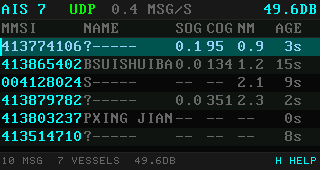 | 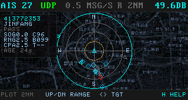 |
| **DOSSIER** | **CONSOLE** |
| 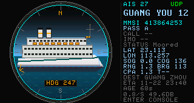 | 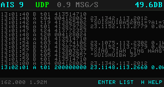 |

Select **AIS** in the `Tab` page menu. `Enter` cycles LIST → PLOT → DOSSIER
→ CONSOLE; `↑`/`↓` scroll, `←`/`→` change target, and `H` shows every key.

- **LIST** — MMSI, name, SOG, COG, distance and age, nearest first. Class A,
  Class B, AtoN and base stations use different markers.
- **PLOT** — north-up PPI with a cached map background, four range rings,
  compass ticks, COG vectors, ten-point trails, a 0.5 NM CPA guard ring and
  a selected-target card. Class A ships are oriented triangles, Class B
  diamonds, AtoN circles and base stations squares. `Up` / `Down` zooms
  from 0.5 to 32 NM (starts at 2 NM).
- **DOSSIER** — 200x170 porthole instrument: gradient sky/sea, compass bezel,
  heading bug and a type-specific side-view ship (cargo, tanker, passenger,
  fishing, sailing, tug, Class B, AtoN, base station), plus MMSI, callsign,
  IMO, navigation status, position, motion, range/bearing, CPA/TCPA,
  destination and ETA. Under-way targets get bow/stern foam and underwater
  flow streaks scaled by SOG, while moored vessels stay calm.
- **CONSOLE** — decoded message log with time, channel, type and MMSI.

CPA/TCPA is calculated for a stationary shore station; targets that are
opening out show `T--` rather than a false zero. A target with CPA below
0.5 NM and TCPA below 10 minutes turns red, sits inside the guard ring and
beeps once every 5 seconds.

### NMEA UDP output

`U` toggles a standard NMEA 0183 feed on UDP port 10110. The output is
`!AIVDM` (single and multipart, with checksums); a message received on both
AIS channels is forwarded once. Point OpenCPN or Signal K at UDP 10110.

```json
"ais": {
  "udp_export": true,
  "udp_host": "255.255.255.255",
  "udp_port": 10110
}
```

Use `127.0.0.1` when the consumer runs on the Cardputer itself, or the
consumer's LAN address if broadcast is filtered. The setting is saved when
`U` is pressed.

AIS reception needs a 162 MHz vertical antenna and plenty of gain; on the
Cardputer Zero / RTL-SDR Blog V4, 49.6 dB worked well while 25–40 dB was too
deaf. The display is a situational view, not calibrated navigation data.

Offline tools:

```sh
./build/ais_replay recording.cu8 --rate 1920000 --nmea
./build/nmea_encoder_test
```

## ACARS aircraft messages

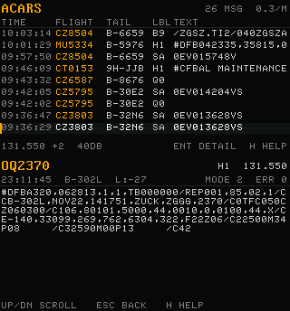

The ACARS page decodes VHF ACARS text messages from aircraft. The decoder is
the bundled `acarsdec` binary at `/usr/lib/zerosdr/acarsdec`. It is
GPLv2-only while ZeroSDR is GPL-3.0, so it is executed as a separate process
and its JSON output is read over loopback UDP; no code is linked into the
application.

`Enter` opens a message, `↑`/`↓` select or scroll, `←`/`→` step to the
previous/next message, `R` restarts the decoder, and `H` shows every key.

ACARS frequencies depend on the region. `131.550 MHz` is the common primary
channel; `129.125` carries a large share of the traffic in some regions, and
the defaults also listen on `131.725` and `131.825`. Override them
in `~/.config/zerosdr/config.json`:

```json
"acars": {
  "channels": [131.550, 131.725, 131.825],
  "gain": 40,
  "udp_port": 5556
}
```

The three default channels span 275 kHz; the decoder runs at 1.536 Msps and
covers them with one tuner setting. ACARS traffic is much sparser than AIS,
so the page can sit on `WAITING FOR ACARS` for a while between messages.
Use a VHF antenna; a quarter wave at 131 MHz is about 57 cm.

Each row shows time, flight, registration, label, payload tag and the first
line of text; `Enter` opens the full message with word wrapping and scrolling.
The detail view also spells out the usual meaning of the label (`H1`
position/weather, `Q0` link test, `5Z` airline-defined, ...) and shows the
sublabel, block id, message number and channel. Airline-specific labels are
hints, not authoritative decodes.

Payload tags classify what the text looks like: `POS` position report, `ATS`
ARINC 622 datalink, `ADSC` ADS-C contract, `SYS` media/system advisory, `TXT`
free text and `---` empty payload (link test or uplink acknowledge). A
`DECODED` block above the raw text shows what could be recovered reliably:
latitude/longitude, departure/arrival airport, report time and an explicit
`ALT` altitude. The raw text is always shown and is never replaced by a guess;
formats that need airline tables (POX tail fields, ARINC 622 internals,
ADS-C binary payloads) are left as text.

Frames the ACARS link layer repeats are merged into one row with an `xN`
counter, and multi-block messages (`msgno` suffix A, B, C ...) are reassembled
into a single text before display. `MULTI` marks a message built from more
than one block.

Airport codes are resolved locally against a filtered OurAirports extract
installed at `/usr/share/zerosdr/airports.csv` (public domain). The detail
view adds a city line such as `BEIJING > SHENZHEN`, and the list shows the
route or the coordinates instead of the raw position text. Airports outside
the table keep their ICAO code. The extract is generated with
`tools/build_airports_csv.py`; the upstream dump is described in
`data/airports-README.md`.

Messages are appended to daily JSONL files under
`~/.local/share/zerosdr/acars/` (`YYYY-MM-DD.jsonl`, one object per line), so
the log is split by date and survives restarts. The list reloads the newest
500 messages and inserts a date header whenever the day changes.

## APRS station tracking

ZeroSDR decodes APRS itself; no TNC or `direwolf` is required. It tunes the
APRS frequency at 1.2 Msps, FM-demodulates in software and runs the Bell 202
AFSK (1200 / 2200 Hz), NRZI, HDLC and CRC-16/X.25 chain in a dedicated
thread. RTL-SDR hardware cannot transmit, so the page is receive-only: it
shows stations, weather and messages but never sends.

Select **APRS** in the `Tab` page menu. `Enter` cycles LIST → MAP → DETAIL →
CONSOLE; `↑`/`↓` zoom the detail/map view, `+`/`-` scroll the detail
text, `←`/`→` select a station and `H` shows every key. `T` cycles the three common frequencies (144.640 / 144.800 /
144.390 MHz) and clears the station table.

| LIST | MAP |
| --- | --- |
| 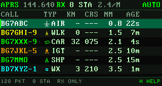 | 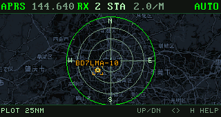 |
| **DETAIL (map + track)** | **CONSOLE** |
| 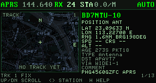 | 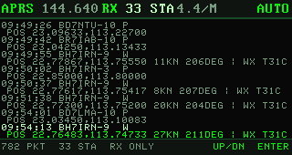 |

The weather block lists every field (wind, gust, temperature, humidity,
pressure and the three rain totals) and scrolls with `↑` / `↓`:

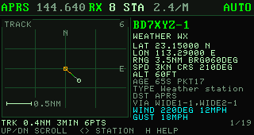

- **LIST** — callsign, type, speed, course, distance and age, nearest first;
  stations without a decoded position are listed last. A callsign dims
  after 30 minutes without a packet and is removed after seven days.
- **MAP** — north-up PPI with the cached map background, four range rings
  and compass ticks. Moving stations are triangles oriented by course,
  weather stations squares and messages circles. The selected station gets
  a crosshair, a callsign label and a connected track line, while other
  stations keep faint trail dots. `Up` / `Down` zoom from 1 to 200 NM
  (starts at 25 NM).
- **DETAIL** — a map/track panel on the left and a scrollable station
  column on the right. The panel is centred on the station's track (or its
  latest position), with the track and start/latest markers. `Up` / `Down`
  zoom the map, `+` / `-` scroll the text, and `Left` / `Right` change
  station. The text lists position, range/bearing, speed/course, altitude,
  age, packet count, symbol type, destination/path, the full weather block
  and the comment.
- **CONSOLE** — two lines per packet: time/source/type and the decoded
  fields (position, speed/course/altitude, weather, message or status).

The APRS symbol table is decoded instead of showing the raw character.
The list has a `TYP` text column (`CAR`, `TRK`, `AIR`, `SHP`, `WX`, `DIG`,
`IGT`, `HOM`, `ANT`, ...) and the detail spells the type out
(`House / QTH`, `Weather station`, `iGate / gateway`, ...).

Weather reports are decoded field by field: wind direction/speed, gust,
temperature, humidity, pressure and rain in the last hour, last 24 hours
and since midnight. The detail column shows all of them with units; the
console summary shows the main values. Positions and tracks are labelled
with units throughout (`NM`, `KN`, `FT`, `DEG`, `MPH`, `HPA`, `MM`).

The DETAIL track panel keeps the recent track of the selected station:
it is drawn on the map, marks the start with a circle and the latest
position with a course arrow, and shows the track length, duration, point
count (`TRK 0.6NM 1MIN 5PTS`). Up to 120 positions from the
last two hours are kept; a new point is added when the station moves more
than about 13 m, so GPS jitter does not fill the history. The same track is
drawn as a line on the MAP view, with older segments dim and the newest
part amber. The selection follows the callsign, not the row number, so it
stays on the same station while new stations appear and the list re-sorts
by distance.

Every decoded packet is appended to a daily history file under
`~/.local/share/zerosdr/aprs/` (`YYYY-MM-DD.jsonl`). On startup the last
seven daily files are replayed into the station table and console, so
stations, recent tracks, weather and the packet log survive a restart. The
files are pruned after seven days, and the in-memory station table follows
the same one-week retention (dimmed after 30 minutes).

The decoder handles uncompressed and compressed positions, Mic-E (the format
used by most Kenwood/Yaesu mobile trackers), messages (receive-only) and
positionless weather reports. A station that only sends weather or status
packets keeps its last known position.

The frequency and gain live in `~/.config/zerosdr/config.json`; `+`/`-` and
`G` change the gain from the page and save it immediately:

```json
"aprs": {
  "frequency": 144640000,
  "gain_tenths": 400,
  "agc": true
}
```

`144.640 MHz` is the common APRS frequency in China; Europe uses 144.800 and
North America 144.390. A 2 m vertical or a 144/430 dual-band antenna works
better than the AIS 162 MHz antenna. APRS traffic is sparse compared with AIS,
so the page can sit on `WAITING FOR APRS` between packets.

An offline replay tool shares the native decoder:

```sh
./build/aprs_replay recording.cu8
```

## Wideband spectrum page

`Tab` opens the page menu (SDR, Spectrum, RFI, ADSB, ACARS, with RADAR,
AIS and APRS on the second row). The spectrum page is a
swept analyzer in the style of qspectrumanalyzer: it retunes the RTL-SDR
across a user supplied range, stitches the slices into one wide spectrum and draws a yellow trace
with a waterfall below it. The RTL-SDR V4 range is 24–1766 MHz.

On first use it asks for START and STOP in MHz. Use the digits and `.`,
`Up`/`Down` to switch fields and `Enter` to accept each field; the range is
saved to the `spectrum` section of `~/.config/zerosdr/config.json` and
reused afterwards.

`←`/`→` pan, `↑`/`↓` zoom, `Enter` resets the span, `R` edits the range and
`H` shows the key list.

Notes:

- Each slice uses a 1.024 MHz sample rate and the middle ~0.78 MHz, with a
  15 ms retune settling time; one step takes roughly 20 ms.
  A 20 MHz range sweeps in well under a second, 100 MHz in a few seconds.
- Wide bins are about 2 kHz; zooming in shows them one bin per pixel.
- The wideband page always uses the tuner's automatic gain (AGC). Fixed
  manual gain amplifies the RTL-SDR's 28.8 MHz clock spur, so it is not
  offered here; use the SDR page's gain control if you need it.
- `Space` toggles display smoothing: a median filter over about 1 MHz of the
  drawn trace, mixed 50/50 with the raw trace. It knocks narrow clock spurs
  down and makes broad signals stand out, while keeping some of a real narrow
  signal. The captured bins, max hold and its decay are not changed; only the
  trace and the new waterfall row are filtered. The status bar shows `SM`
  while it is on.
- Max hold is on by default (red envelope); `P` toggles it and clears the
  stored peaks. The envelope decays at 1.5 dB/s
  (`spectrum.max_hold_decay_db_s`; set 0 to hold forever), so stale peaks
  fall away while a persistent signal keeps refreshing its level.
- `M` cycles the waterfall palette: CLASSIC, DEFAULT, TURBO, INFERNO,
  VIRIDIS and PLASMA. The choice is saved as `spectrum.theme` and restored
  on the next start.
- `L` toggles peak labels: the strongest local maxima in the visible trace
  are tagged with their frequency in MHz (up to three, kept apart so the
  labels do not overlap). The choice is saved as `spectrum.peak_labels`.
- The waterfall window is cleared when you pan or zoom so stale history from
  another part of the band is not shown.
- The page stops the SDR capture when you leave it, releasing the dongle for
  the SDR and ADSB pages.

## Command line options

```text
Usage: zerosdr [options]
  -f <freq>     Center frequency in Hz (default: 100000000)
  -s <rate>     Sample rate in Hz (default: 1024000)
  -g <gain>     Gain in dB (default: auto)
  -d <device>   Framebuffer device (default: /dev/fb0)
  -k <device>   Keyboard input device (default: auto-detect)
  -h            Show help
```

## Troubleshooting

### Waterfall looks empty but audio is clear

Broadcast FM tolerates being slightly off frequency: a station 100 kHz away
from the displayed centre still demodulates cleanly, while its peak sits just
right/left of the red centre line. Tune exactly onto the peak (the `T` step is
100 kHz in FM AUTO mode) if you want it centred.

The narrow bright line exactly at the centre is the RTL-SDR DC / LO leakage,
not a station. A real broadcast station is a ~200 kHz wide plateau.

### Loud noise on empty frequencies

With squelch off (`SQ:OFF`) and audio AGC on, demodulated noise is amplified to
almost full scale. Press `S` to raise the squelch; the noise gates out and only
real signals come through.

### RTL-SDR not detected / permission denied

`Please fix the device permissions, e.g. by installing the udev rules file
rtl-sdr.rules` means the USB node belongs to root and your desktop user cannot
open it. ZeroSDR runs as that user, so `sudo zerosdr` working is not the fix.

```bash
lsusb | grep -i 0bda
ls -l /dev/bus/usb/*/*      # root:plugdev 0660, or root:root 0664
groups                     # plugdev should be listed
```

Add yourself to `plugdev` and log out/in (or reboot), then re-plug the dongle:

```bash
sudo usermod -aG plugdev "$USER"
```

The Debian package ships `/usr/lib/udev/rules.d/99-zerosdr.rules`, which grants the
common RTL2832U IDs (`0bda:2832`, `0bda:2838`) mode 0666 so membership is not
required. If the rules are missing, create them by hand:

```bash
sudo tee /etc/udev/rules.d/99-zerosdr.rules >/dev/null <<'EOF'
SUBSYSTEMS=="usb", ATTRS{idVendor}=="0bda", ATTRS{idProduct}=="2832", MODE="0666"
SUBSYSTEMS=="usb", ATTRS{idVendor}=="0bda", ATTRS{idProduct}=="2838", MODE="0666"
EOF
sudo udevadm control --reload-rules && sudo udevadm trigger
```

The rule is installed as `99-zerosdr.rules` so it is applied after the
`99-kismet-*.rules` that Kismet uses to put SDR devices in its own group. If
Kismet is installed and you want both, add your user to `kismet` instead.

### Device busy

```bash
sudo pkill readsb
sudo pkill -f rtl_
```

### No audio

```bash
aplay -L | head             # "default" should point at PipeWire
amixer -c 1 sget Speaker
```

On a minimal image the ALSA `default` route may be missing (the app then logs
`Cannot open audio device default`). ZeroSDR automatically falls back to
`pulse` / `pipewire` / the codec device; install `libasound2-plugins` if none of
them exist:

```bash
sudo apt-get install -y libasound2-plugins
```

The wrapper sets `DACL/DACR Playback Volume` to 179 (-6 dB); 0 dB causes the
ES8389 amplifier to drop out.

`Fn`+`D` / `Fn`+`S` adjust the **system** sink volume on every page. The
launcher's labwc binding normally performs a 5% step; if the sink did not move
within 300 ms, ZeroSDR applies its own 10% step so the keys also work without
the launcher. The SDR status bar follows the sink (volume-up also unmutes),
and the spectrum/ADSB pages show a short `VOL n%` popup. Bare `V` / `C` are
not volume keys. If the launcher was left at a low volume, check it before
suspecting the SDR chain:

```bash
wpctl get-volume @DEFAULT_AUDIO_SINK@
pactl list sinks | grep Volume
```

### Frequency offset

```bash
rtl_test -p                 # PPM measurement
```

A few ppm is normal (e.g. -27 ppm ≈ 2.7 kHz at 100 MHz). Large offsets usually
mean an old rtl-sdr driver.

### Blank screen / wrong display

```bash
cat /proc/fb
ls -l /dev/fb*
```

Run manually to isolate APPLaunch:

```bash
/usr/share/APPLaunch/bin/zerosdr -d /dev/fb_lcd \
    -k /dev/input/by-path/platform-3f804000.i2c-event
```

## Cross-compilation

```bash
sudo apt-get install -y gcc-aarch64-linux-gnu g++-aarch64-linux-gnu libfreetype-dev

cmake -S . -B build-aarch64 -DCMAKE_BUILD_TYPE=Release \
  -DCMAKE_SYSTEM_NAME=Linux \
  -DCMAKE_SYSTEM_PROCESSOR=aarch64 \
  -DCMAKE_C_COMPILER=aarch64-linux-gnu-gcc \
  -DCMAKE_CXX_COMPILER=aarch64-linux-gnu-g++
cmake --build build-aarch64 -j"$(nproc)"

scp build-aarch64/zerosdr pi@<cardputer-ip>:/tmp/
```

## License

This project is licensed under the GNU General Public License v3.0 — see the
[LICENSE](LICENSE) file for details.

The RTL-SDR V4 mount files in
[`hardware/rtl-sdr-v4-mount/`](hardware/rtl-sdr-v4-mount/) are released under
CC0 1.0, separately from the GPLv3 application code.

## Acknowledgments

- Built with [rtl-sdr](https://github.com/osmocom/rtl-sdr)
- Designed for M5Stack Cardputer Zero
