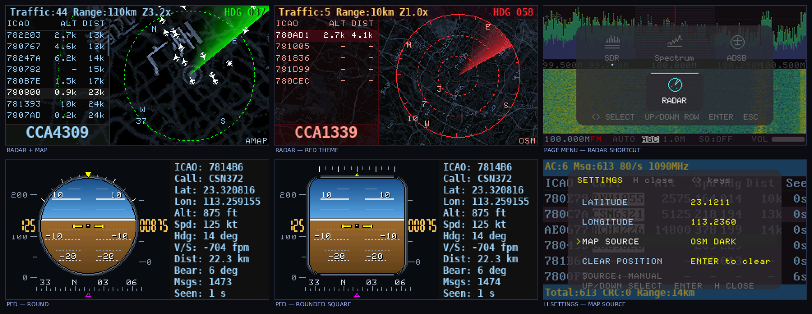
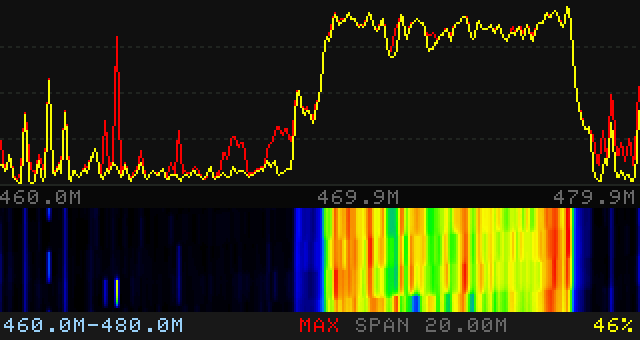
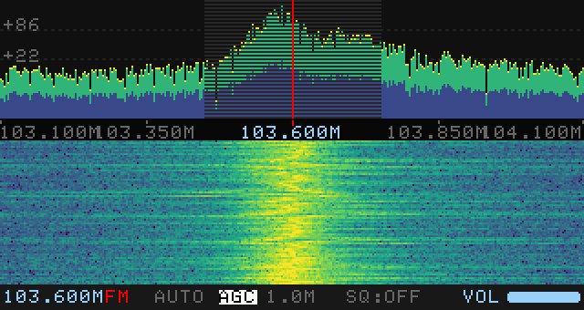
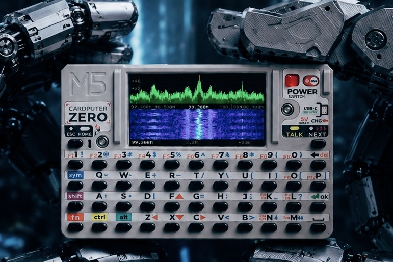
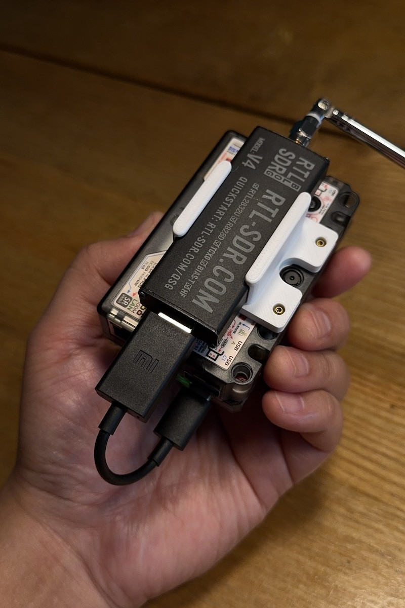

# zeroSDR

[](https://www.gnu.org/licenses/gpl-3.0)
[]()

**English** | [简体中文](README.zh-CN.md)

zeroSDR is an open source SDR receiver for Linux-based small-screen embedded
systems. It renders the spectrum and waterfall straight into the framebuffer
and demodulates FM / NFM / AM / USB / LSB audio through ALSA.



*ADSB radar with a map and the red tech theme, the RADAR shortcut in the
page menu, the round / rounded-square PFD and the map source in the `H`
settings.*

> **Press `H` on the SDR page to show the on-screen key list.**
> Press `→` there to switch to the settings tab (FM de-emphasis, audio AGC,
> FFT size, sample rate). Press `H` again to close.

| | |
|:---:|:---:|
|  |  |
| Wideband spectrum page: 460–480 MHz sweep with max hold | SDR page: 103.6 MHz FM with spectrum and waterfall |

## Features

- Real-time spectrum and waterfall on a 320x170 framebuffer
- FM / NFM / AM / USB / LSB demodulation with squelch, audio AGC and
  FM de-emphasis (50/75 µs)
- Hardware AGC / manual gain, display zoom, FFT size and sample-rate presets
- On-screen key reference and settings (`H`); `Tab` page menu with a RADAR
  shortcut
- Wideband swept spectrum page: custom start/stop, pan/zoom, max hold and six
  colour themes
- ADSB list sorted by distance; holding `F` jumps back to the top
- ADSB radar with Esri / AMap / OSM map backgrounds (dark AMap/OSM), gyro
  heading-up, `R` / `T` zoom and a red tech theme (`M`)
- ADSB detail PFD: round or rounded-square attitude ball (`M`), pitch ladder,
  bank pointer, speed/altitude tapes and an audio variometer
- System volume from every page (`Fn`+`D` / `Fn`+`S`)
- Runs as the normal desktop user (no root) via the librtlsdr udev rule
- Optimized for Raspberry Pi Zero 2W / Pi 5 and the M5Stack Cardputer Zero

## Hardware



*Cardputer Zero (M5Stack CM0) running zeroSDR.*

- Raspberry Pi 5 / Pi Zero 2W / M5Stack Cardputer Zero (CM0, aarch64)
- RTL-SDR dongle (tested: RTL-SDR Blog V4, RTL2832U)
- 320x170 framebuffer display (`/dev/fb0`, on Cardputer Zero also `/dev/fb_lcd`)
- Latest rtl-sdr drivers (critical for correct tuning)
- Optional: [3D-printed RTL-SDR V4 mount](#rtl-sdr-v4-mount)

## RTL-SDR V4 mount

A 3D-printed mount designed by the zeroSDR author for the RTL-SDR Blog V4
dongle. It clamps the dongle to the back of the Cardputer Zero, so the receiver
and the antenna connector travel as one unit; a short USB-C cable loops back to
the device.

<a href="hardware/rtl-sdr-v4-mount/CardputerZero_RTLSDR_V4_mount.jpg"></a>

Printable STL:
[CardputerZero_RTLSDR_V4_mount.stl](hardware/rtl-sdr-v4-mount/CardputerZero_RTLSDR_V4_mount.stl).
It needs two M2 x 6 mm screws (not included) and is released under
[CC0 1.0](hardware/rtl-sdr-v4-mount/LICENSE). Sizing and print notes are in the
[mount directory](hardware/rtl-sdr-v4-mount/).

## Quick start (desktop / Raspberry Pi)

```bash
sudo apt-get update
sudo apt-get install -y build-essential cmake librtlsdr-dev libasound2-dev libpulse-dev libfreetype-dev nlohmann-json3-dev curl

cmake -S . -B build -DCMAKE_BUILD_TYPE=Release
cmake --build build -j"$(nproc)"

./build/zerosdr                    # defaults: 100 MHz, 1.024 MS/s, auto gain
./build/zerosdr -f 99300000        # 99.3 MHz FM
./build/zerosdr -s 2048000 -g 20   # custom sample rate and gain
```

`Release` build is required on the CM0: FFT + demodulation + resampling all run
in real time on four small cores.

## Install on Cardputer Zero

zeroSDR is in the Cardputer Zero AppStore: open the store, find **zeroSDR** and
install it. On the device shell the same package is:

```bash
sudo apt update && sudo apt install zerosdr
```

It installs the binary, the APPLaunch entry and icon, and the `readsb` decoder
with the RTL-SDR backend, so nothing else needs to be set up.

## Manual deployment on Cardputer Zero

The AppStore / `.deb` package is the recommended path. For a manual install,
build with `Release`, then copy the binary, wrapper and launcher files:

```bash
cmake -S . -B build -DCMAKE_BUILD_TYPE=Release
cmake --build build -j"$(nproc)"
sudo install -Dm755 build/zerosdr /usr/share/APPLaunch/bin/zerosdr
sudo install -Dm755 share/bin/run-zerosdr /usr/share/APPLaunch/bin/run-zerosdr
sudo install -Dm644 share/APPLaunch/applications/zerosdr.desktop \
    /usr/share/APPLaunch/applications/zerosdr.desktop
sudo install -Dm644 share/images/zerosdr.png \
    /usr/share/APPLaunch/share/images/zerosdr.png
systemctl --user restart APPLaunch.service
```

`run-zerosdr` selects the LCD framebuffer and keyboard, reuses APPLaunch's
PipeWire session and keeps the ES8389 DAC at -6 dB. Runtime needs only the
standard librtlsdr udev rule (no root); on a fresh system install that rule or
add your user to `plugdev`.

Full walkthrough and recovery notes: [cardputerzero.md](cardputerzero.md) (Chinese).
Build/package details: [BUILD.md](BUILD.md).

To build the package instead:

```bash
dpkg-buildpackage -us -uc -b
sudo dpkg -i ../zerosdr_*.deb
```

### Uninstall

```bash
sudo rm -f /usr/share/APPLaunch/bin/zerosdr \
           /usr/share/APPLaunch/bin/run-zerosdr \
           /usr/share/APPLaunch/applications/zerosdr.desktop \
           /usr/share/APPLaunch/share/images/zerosdr.png
systemctl --user restart APPLaunch.service
```

## First run

On the first start zeroSDR shows a short guide (reopen it from
`H` → settings → `SHOW GUIDE`):

- `H` opens the key list and settings
- `Tab` opens the page menu (SDR, Spectrum, ADSB and a RADAR shortcut)
- `Enter` cycles the ADSB views (radar → detail → list)
- `M` toggles the SDR / radar colour theme
- Observer position: entered by hand, or read from a GPS when one is present
  (gpsd or a serial NMEA device). A manual entry overrides GPS until the
  position is cleared. The editor accepts negative values (southern/western
  coordinates): press `SYM`+`R` for the minus sign; pressing it again removes
  the sign.

## Keyboard controls

### Press `H` first

`Tab` opens a translucent page menu: `←`/`→` (or `Tab`) select a page,
`↑`/`↓` move between the page row and the RADAR shortcut row, `Enter` opens
it, `Esc` closes the menu. The RADAR tile jumps straight into the ADSB radar
view.

The SDR page has a built-in reference:

```text
H          open / close the overlay
← / →      switch between the key list and the settings tab
↑ / ↓      select a setting
Enter      change the selected setting
```

### Cardputer Zero keymap

The TCA8418 keyboard is detected automatically (`tca8418c`). Plain
`F`/`Z`/`X`/`C` act as arrow keys, `Fn` combinations emit the standard special
codes, and plain letters are used for the SDR controls.

| Key | Action |
|-----|--------|
| `Z` / `←` | Tune down |
| `C` / `→` | Tune up |
| `F` / `↑` | Gain up |
| `X` / `↓` | Gain down |
| `Alt`+`Z`/`C` | Coarse tune (step × 10) |
| `0-9` `.` | Direct frequency input (MHz) |
| `Enter` | Apply frequency |
| `Backspace` | Delete last digit |
| `Esc` | Cancel input |
| `D` | Cycle demodulation mode (FM/NFM/AM/USB/LSB) |
| `B` / `Fn`+`B` | Cycle demodulation bandwidth |
| `Fn`+`D` | System volume up (any page) |
| `Fn`+`S` | System volume down (any page) |
| `S` | Squelch (+5%; hold >0.5 s = 10%, >1.5 s = 25%) |
| `T` | Cycle tuning step (Auto/100/1k/5k/10k/100k/1M) |
| `Space` / `Fn`+`A` | Audio on/off |
| `G` | Hardware AGC on/off |
| `M` | Color theme for spectrum and waterfall |
| `Y` | Display zoom (only spans the sample rate can fill) |
| `Fn`+`P` (F12) | Screenshot (`~/zerosdr_screenshot_*.png`) |
| `H` | Key list, then `→` for settings |
| `Tab` | Page menu (select with arrows, `Enter` opens) |
| `Esc` (hold 2 s) | Quit, with a centered progress prompt |

### PC keyboard

| Key | Action |
|-----|--------|
| `←` `→` | Tune (Alt = coarse); hold to repeat and accelerate |
| `Alt`+`Z`/`C` | Coarse tune (step × 10) |
| `↑` `↓` | Gain |
| `D` | Demodulation mode |
| `B` / `Shift+B` | Demodulation bandwidth |
| `Space` | Audio on/off |
| `S` | Squelch |
| `T` | Tuning step |
| `M` | Color theme |
| `Shift+Z` | Display zoom |
| `Shift+R` | FFT size |
| `Shift+S` | Screenshot |
| `H` | Key list / settings |
| `Tab` | Page menu |
| `Esc` (hold 2 s) | Quit, with a centered progress prompt |

## Settings (`H` → `→`)

Rarely changed options live in the settings tab instead of hotkeys:

| Item | Values | Default |
|------|--------|---------|
| FM de-emphasis | 50 µs (CN/EU/Asia) / 75 µs (US) | 50 µs |
| Audio AGC | On / Off | On |
| FFT size | 256 / 512 / 1024 / 2048 | 512 |
| Sample rate | 1.024 / 1.2 / 1.8 / 2.048 / 2.4 MHz | 1.024 MHz |
| First-run guide | `SHOW GUIDE`: reopen it now | — |

Changing the sample rate resets the display span to the widest level that fits
the new band (1.2 M → 1.0 M, 2.048 M → 2.0 M), so `Y` never appears to do
nothing because the stored span was wider than the captured bandwidth.

All settings live in `~/.config/zerosdr/config.json`. The older
`sdr_settings.json`, `spectrum_range.txt`, `adsb_config.json` and `guide.json`
are imported once on first start and are no longer updated.

### Radar map background

The ADSB radar can fetch a low-detail raster patch and draw it as the scope
background. By default it fills the whole display, with the list and status
bar slightly translucent over it. It is optional, cached and downloaded by a
worker thread, so a slow or missing network never blocks the radar.

Default provider is **Esri World Dark Gray Base**: dark, no text labels and no
API key. Other values for `map.provider`:

| Provider | Notes |
|---|---|
| `esri_dark` | Default. No key, no labels, coastlines/rivers/land. |
| `esri_imagery` | Satellite imagery. No key, but noisier. |
| `osm` | Standard OSM tiles; shown as `OSM DARK` by default. |
| `amap` | Gaode web tiles. WGS-84 is converted to GCJ-02. |
| `carto_dark_nolabels` | CARTO now watermarks keyless tiles; use only with a keyed custom URL. |
| `custom` | Uses `map.url_template` with `{z}`, `{x}`, `{y}`. |

- `L` (or `H` → settings) opens the map source row; Enter on `Map source`
  cycles `ESRI DARK -> AMAP -> OSM -> ESRI DARK` and saves the choice
  immediately.
- By default a 5×5 tile grid is downloaded and cropped to a 1024×1024 patch
  centred on the observer, enough to fill the whole screen. Set
  `full_screen=false` for the older 3×3 / 512×512 patch clipped to the scope
  circle. Patches are cached in `~/.cache/zerosdr/radar_map/`.
- `dim` is the map opacity over the dark radar background (0.1–1.0). The
  Esri dark canvas is lifted with a midtone gamma so coastlines and rivers
  stay visible on the small panel.
- `dark` (optional) inverts, desaturates and blue-tints a light map. It
  defaults to `true` for `amap` and `osm`, so those sources are shown as
  `AMAP DARK` / `OSM DARK`; Esri dark leaves it off. Set `"dark": false` to
  see the original light style.
- `proxy` may be a standard proxy URL such as
  `socks5h://192.168.31.59:1082`; empty means direct or the inherited
  `https_proxy` environment variable.
- The download uses the system `curl` command, so the package depends on
  `curl`.
- Attribution is drawn small at the bottom-right of the scope. Esri, OSM and
  AMap data have their own attribution/usage terms.
- If the download fails, the previous patch (or the plain dark background)
  stays in use. Failed keys back off for 60 seconds.
- Carto's public tiles now require an API key; without one they contain an
  "API KEY REQUIRED" watermark. Use `esri_dark` for a keyless default.

## Demodulation bandwidth presets

**FM (broadcast)**: 200 / 250 / **300** / 400 / 500 kHz
**NFM**: 6.25 / **12.5** / 25 kHz
**AM**: 5 / **10** / 15 kHz
**SSB (USB/LSB)**: 2.4 / 2.7 / 3.0 kHz

## Display zoom levels

`Y` cycles 50k / 100k / 200k / 500k / 1M / 2M / 2.8M / 3.2M, limited to what
the current sample rate can fill.

## ADSB page

`Tab` opens the page menu (SDR, Spectrum, ADSB and a RADAR shortcut). In the
ADSB list:

| Key | Action |
|-----|--------|
| `↑` / `↓` | Select aircraft |
| Hold `F` (up) | Jump to the top of the list |
| `←` / `→` | Move 5 rows |
| `Enter` | Cycle views: radar → detail → list → radar |
| `I` | Toggle heading-up / north-up radar (needs the IMU compass) |
| `0` | Zero the compass: point the top edge north, then press |
| `H` | Key list + settings (latitude, longitude, map source, clear position) |
| `L` | Settings: observer position + map source |
| `G` / `+` / `-` | Radar gain mode / gain (list and detail) |
| `M` | PFD shape (detail) / red radar theme (radar view) |
| `R` / `T` | Zoom the radar scope out / in (radar view) |
| `Tab` | Page menu |

The list is sorted by distance, nearest first; aircraft without a decoded
position go last. The radar's left panel lists `ICAO` / altitude / distance,
with the selected aircraft's callsign shown in large text on a dim strip that
spans the full width of the panel. The callsign and the ADSB status/detail text are rendered
with an anti-aliased TrueType font.

The detail view has a full-height pixel-style PFD on the left (200 px) and
the aircraft text column on the right (120 px). There is no frame and no
bottom status bar. A big circular attitude ball with a gradient sky/ground, a
rotating horizon bar, a pitch ladder and bank pointer fills the left column,
with frameless speed and altitude scales on either side and a heading strip at
the bottom. Speed and altitude are amber seven-segment digits drawn directly
on the panel; the altitude readout keeps leading zeros and its last two
digits are independent wheels (ones rolls every foot, tens only on the
carry); each change is a single roll, up for a climb and down for a descent.
The detail view also has an audio variometer: dense short dots play only
while the altitude digits are rolling (each new sample gives one short
burst), with the spacing tightening as the climb/descent rate grows, and a
rising pitch for a climb and a falling pitch for a descent. The callsign is
not repeated inside the PFD; the right-hand text column keeps `Call:` together
with the ICAO/position data. Pitch is derived from vertical rate and ground speed;
bank is estimated from the track change rate.

### Compass (BMI270 + BMM150)

Some Cardputer Zero boards carry a BMI270 accelerometer and a BMM150
magnetometer (the magnetometer is reached through the BMI270 auxiliary I²C
bus). zeroSDR reads both through the kernel's IIO sysfs devices, so no extra
driver, daemon or permission is needed. When they are present the radar can be
**heading-up**: the compass rose rotates so that the direction the top edge of
the device points is at the top of the scope, and the aircraft blips (and the
sweep) turn with it.

- `I` toggles heading-up / north-up. The status bar shows `HDG 123`, bright
  while heading-up is active and dim while the compass keeps tracking in
  north-up.
- `0` stores a compass zero: point the top edge north first (or true north to
  fold in the local magnetic declination), then press it. The offset is kept
  in the config file.
- The heading uses the BMI270 gyro (projected on gravity, so it works while
  the board is tilted) and falls back to the tilt-compensated magnetometer.
  The magnetometer is only trusted when its field magnitude looks like
  Earth's (~0.2–1.2 gauss); the BMM150 sits next to the speaker magnet on
  this board, where it reads several gauss and barely rotates.
- With a compromised magnetometer the gyro carries the heading; `0` aligns
  the current direction to north. `imu.invert` flips the rotation direction.
- On boards without the IMU the radar simply stays north-up and `I` beeps.

Settings live in `~/.config/zerosdr/config.json`:

```json
"imu": {
  "enabled": true,
  "heading_up": true,
  "offset_deg": 0.0,
  "invert": false
}
```

`offset_deg` rotates the rose to match how the chip is mounted in the case (and
can absorb the declination); `invert` flips the rotation direction for a mirrored
mount.

The observer position can come from a GPS receiver (gpsd on port 2947 or an
NMEA stream on `/dev/serial0`, `/dev/ttyAMA0`, `/dev/ttyS0`, `/dev/ttyUSB0`
or `/dev/ttyACM0`). The last fix is remembered; a manually entered position
takes precedence until it is cleared, and the ADSB settings overlay shows
whether the current source is GPS, MANUAL, SAVED or NOT SET.

ADSB decoding is done by a `readsb` build with the RTL-SDR backend that ships
inside this package (`/usr/lib/zerosdr/readsb`); no separate decoder install is
needed. A system `/usr/bin/readsb` is used as a fallback if present.

`H` opens a translucent rounded popup with two tabs: the key list and a settings tab
where you can view/edit the observer latitude and longitude (opening the usual
position editor) or clear the stored position. In the editor `SYM`+`R` types a
minus sign (press it again to clear the sign), so southern and western
coordinates work the same way as positive ones. `←`/`→` switch tabs, `↑`/`↓`
select, `Enter` edits, `H` closes.

Audio feedback:

- a short beep when the list selection moves,
- one sonar ping per radar revolution (6 s at 60°/s),
- a quiet tick every 90° of the sweep,
- a two-tone chime when a new aircraft appears (at most once every 3 s).

## Wideband spectrum page

`Tab` opens the page menu (SDR, Spectrum, ADSB, plus a RADAR shortcut on the
second row). The spectrum page is a
swept analyzer in the style of qspectrumanalyzer: it retunes the RTL-SDR
across a user supplied range, stitches the slices into one wide spectrum and draws a yellow trace
with a waterfall below it. The RTL-SDR V4 range is 24–1766 MHz.

On first use it asks for START and STOP in MHz. Use the digits and `.`,
`Up`/`Down` to switch fields and `Enter` to accept each field; the range is
saved to the `spectrum` section of `~/.config/zerosdr/config.json` and
reused afterwards.

| Key | Action |
|-----|--------|
| `←` / `→` | Pan the visible window |
| `↑` / `↓` or `+` / `-` | Zoom in / out |
| `Enter` | Reset to the full configured range |
| `M` | Toggle max hold (red peak trace, decays at 1.5 dB/s) |
| `Space` | Toggle display smoothing (median over ~1 MHz) |
| `R` | Edit the start/stop range |
| `H` | Toggle the translucent help overlay |
| `Tab` | Page menu (select with arrows, `Enter` opens) |
| `Esc` (hold 2 s) | Quit, with the centered progress prompt |

Notes:

- Each slice uses a 1.024 MHz sample rate and the middle ~0.78 MHz, with a
  15 ms retune settling time; one step takes roughly 20 ms.
  A 20 MHz range sweeps in well under a second, 100 MHz in a few seconds.
- Wide bins are about 2 kHz; zooming in shows them one bin per pixel.
- The wideband page always uses the tuner's automatic gain (AGC). Fixed
  manual gain amplifies the RTL-SDR's 28.8 MHz clock spur, so it is not
  offered here; use the SDR page's gain control if you need it.
- `Space` toggles display smoothing: a median filter over about 1 MHz of the
  drawn trace, mixed 50/50 with the raw trace. It knocks narrow clock spurs
  down and makes broad signals stand out, while keeping some of a real narrow
  signal. The captured bins, max hold and its decay are not changed; only the
  trace and the new waterfall row are filtered. The status bar shows `SM`
  while it is on.
- Max hold is on by default (red envelope); `M` toggles it and clears the
  stored peaks. The envelope decays at 1.5 dB/s
  (`spectrum.max_hold_decay_db_s`; set 0 to hold forever), so stale peaks
  fall away while a persistent signal keeps refreshing its level.
- The waterfall window is cleared when you pan or zoom so stale history from
  another part of the band is not shown.
- The page stops the SDR capture when you leave it, releasing the dongle for
  the SDR and ADSB pages.

## Command line options

```text
Usage: zerosdr [options]
  -f <freq>     Center frequency in Hz (default: 100000000)
  -s <rate>     Sample rate in Hz (default: 1024000)
  -g <gain>     Gain in dB (default: auto)
  -d <device>   Framebuffer device (default: /dev/fb0)
  -k <device>   Keyboard input device (default: auto-detect)
  -h            Show help
```

## Troubleshooting

### Waterfall looks empty but audio is clear

Broadcast FM tolerates being slightly off frequency: a station 100 kHz away
from the displayed centre still demodulates cleanly, while its peak sits just
right/left of the red centre line. Tune exactly onto the peak (the `T` step is
100 kHz in FM AUTO mode) if you want it centred.

The narrow bright line exactly at the centre is the RTL-SDR DC / LO leakage,
not a station. A real broadcast station is a ~200 kHz wide plateau.

### Loud noise on empty frequencies

With squelch off (`SQ:OFF`) and audio AGC on, demodulated noise is amplified to
almost full scale. Press `S` to raise the squelch; the noise gates out and only
real signals come through.

### RTL-SDR not detected / permission denied

```bash
lsusb | grep -i 0bda
ls -l /dev/bus/usb/*/*      # expect root:plugdev 0660
groups pi                   # expect plugdev, video, audio, input
```

Re-plug the dongle after installing/updating `librtlsdr0`.

### Device busy

```bash
sudo pkill readsb
sudo pkill -f rtl_
```

### No audio

```bash
aplay -L | head             # "default" should point at PipeWire
amixer -c 1 sget Speaker
```

On a minimal image the ALSA `default` route may be missing (the app then logs
`Cannot open audio device default`). zeroSDR automatically falls back to
`pulse` / `pipewire` / the codec device; install `libasound2-plugins` if none of
them exist:

```bash
sudo apt-get install -y libasound2-plugins
```

The wrapper sets `DACL/DACR Playback Volume` to 179 (-6 dB); 0 dB causes the
ES8389 amplifier to drop out.

`Fn`+`D` / `Fn`+`S` adjust the **system** sink volume on every page. The
launcher's labwc binding normally performs a 5% step; if the sink did not move
within 300 ms, zeroSDR applies its own 10% step so the keys also work without
the launcher. The SDR status bar follows the sink (volume-up also unmutes),
and the spectrum/ADSB pages show a short `VOL n%` popup. Bare `V` / `C` are
not volume keys. If the launcher was left at a low volume, check it before
suspecting the SDR chain:

```bash
wpctl get-volume @DEFAULT_AUDIO_SINK@
pactl list sinks | grep Volume
```

### Frequency offset

```bash
rtl_test -p                 # PPM measurement
```

A few ppm is normal (e.g. -27 ppm ≈ 2.7 kHz at 100 MHz). Large offsets usually
mean an old rtl-sdr driver.

### Blank screen / wrong display

```bash
cat /proc/fb
ls -l /dev/fb*
```

Run manually to isolate APPLaunch:

```bash
/usr/share/APPLaunch/bin/zerosdr -d /dev/fb_lcd \
    -k /dev/input/by-path/platform-3f804000.i2c-event
```

## Cross-compilation

```bash
sudo apt-get install -y gcc-aarch64-linux-gnu g++-aarch64-linux-gnu libfreetype-dev

cmake -S . -B build-aarch64 -DCMAKE_BUILD_TYPE=Release \
  -DCMAKE_SYSTEM_NAME=Linux \
  -DCMAKE_SYSTEM_PROCESSOR=aarch64 \
  -DCMAKE_C_COMPILER=aarch64-linux-gnu-gcc \
  -DCMAKE_CXX_COMPILER=aarch64-linux-gnu-g++
cmake --build build-aarch64 -j"$(nproc)"

scp build-aarch64/zerosdr pi@<cardputer-ip>:/tmp/
```

## License

This project is licensed under the GNU General Public License v3.0 — see the
[LICENSE](LICENSE) file for details.

The RTL-SDR V4 mount files in
[`hardware/rtl-sdr-v4-mount/`](hardware/rtl-sdr-v4-mount/) are released under
CC0 1.0, separately from the GPLv3 application code.

## Acknowledgments

- Built with [rtl-sdr](https://github.com/osmocom/rtl-sdr)
- Designed for M5Stack Cardputer Zero
