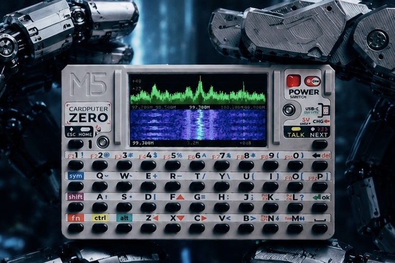

# zeroSDR

[](https://www.gnu.org/licenses/gpl-3.0)
[]()

**简体中文** | [English](README.md)

zeroSDR 是一个面向小屏幕嵌入式 Linux 的开源 SDR 接收程序。频谱和瀑布直接画进
framebuffer，音频解调（FM / NFM / AM / USB / LSB）通过 ALSA 输出。



> **在 SDR 页面按 `H` 可以随时显示屏幕按键列表。**
> 在列表页按 `→` 切到设置页（FM 去加重、音频 AGC、FFT 大小、采样率），
> 再按 `H` 关闭。

## 功能

- 320×170 framebuffer 上的实时频谱与瀑布
- FM / NFM / AM / USB / LSB 解调，带静噪、音频 AGC、FM 去加重（50/75 µs）
- 硬件 AGC / 手动增益、显示缩放、FFT 大小、采样率预设
- 屏幕按键列表 + 设置页（`H`）
- ADSB 飞机页面（readsb），含雷达/PFD 视图
- 借助 librtlsdr 的 udev 规则，以普通用户运行，**不需要 root**
- 针对 Raspberry Pi Zero 2W / Pi 5 与 M5Stack Cardputer Zero 优化

## 硬件要求

- Raspberry Pi 5 / Pi Zero 2W / M5Stack Cardputer Zero（CM0，aarch64）
- RTL-SDR 电视棒（已验证：RTL-SDR Blog V4，RTL2832U）
- 320×170 framebuffer 屏幕（`/dev/fb0`，Cardputer Zero 上还有 `/dev/fb_lcd`）
- 尽量新的 rtl-sdr 驱动（直接影响调谐准确性）

## 快速开始（桌面 / 树莓派）

```bash
sudo apt-get update
sudo apt-get install -y build-essential cmake librtlsdr-dev libasound2-dev

cmake -S . -B build -DCMAKE_BUILD_TYPE=Release
cmake --build build -j"$(nproc)"

./build/zerosdr                    # 默认：100 MHz、1.024 MS/s、自动增益
./build/zerosdr -f 99300000        # 99.3 MHz FM
./build/zerosdr -s 2048000 -g 20   # 指定采样率和增益
```

在 CM0 上**必须用 Release 构建**：FFT、解调、重采样要在四个小核上实时跑。

## Cardputer Zero 手动部署

APPLaunch 以桌面用户 `pi` 启动应用，`Exec` / `Icon` 按 `/usr/share/APPLaunch`
为根解析。最终目录：

```text
/usr/share/APPLaunch/
├── applications/zerosdr.desktop
├── bin/zerosdr                 # 主程序
├── bin/run-zerosdr             # wrapper：屏幕 / 键盘 / 音频准备
└── share/images/zerosdr.png    # 图标
```

### 1. 在设备上构建（推荐）

```bash
sudo apt-get install -y build-essential cmake librtlsdr-dev libasound2-dev
cd ~/zerosdr
cmake -S . -B build -DCMAKE_BUILD_TYPE=Release
cmake --build build -j"$(nproc)"
file build/zerosdr        # 应显示 ARM aarch64
```

### 2. 安装主程序

```bash
sudo install -d /usr/share/APPLaunch/bin
sudo install -m 755 build/zerosdr /usr/share/APPLaunch/bin/zerosdr
```

### 3. 安装启动 wrapper

APPLaunch 的 `Terminal=false` 模式不经过 shell，所以 `-d /dev/fb_lcd` 这类参数
不能直接写在 `Exec` 里。wrapper 还负责复用用户的 PipeWire 会话，并把 ES8389
DAC 固定在 -6 dB（0 dB 会周期性断音）。

```bash
sudo tee /usr/share/APPLaunch/bin/run-zerosdr >/dev/null <<'EOF'
#!/bin/sh
set -eu

# APPLaunch 在用户会话里启动应用；复用其 PipeWire runtime。
if [ -z "${XDG_RUNTIME_DIR:-}" ]; then
    for d in /run/user/*; do
        if [ -S "$d/pipewire-0" ]; then
            XDG_RUNTIME_DIR="$d"
            break
        fi
    done
fi
if [ -n "${XDG_RUNTIME_DIR:-}" ]; then
    export XDG_RUNTIME_DIR
    export PIPEWIRE_RUNTIME_DIR="$XDG_RUNTIME_DIR"
fi

# 128 帧 quantum 在 CM0 上会产生周期性 xrun。
if command -v pw-metadata >/dev/null 2>&1; then
    pw-metadata -n settings 0 clock.force-quantum 1024 >/dev/null 2>&1 || true
fi

# ES8389 功放在 0 dB 会断音；179 = -6 dB。
amixer -c 1 cset name='DACL Playback Volume' 179 >/dev/null 2>&1 || true
amixer -c 1 cset name='DACR Playback Volume' 179 >/dev/null 2>&1 || true

# LCD framebuffer。
if [ -n "${LV_LINUX_FBDEV_DEVICE:-}" ]; then
    FB="$LV_LINUX_FBDEV_DEVICE"
elif [ -e /dev/fb_lcd ]; then
    FB=/dev/fb_lcd
else
    FB=/dev/fb0
fi

# TCA8418 键盘。
KBD=/dev/input/by-path/platform-3f804000.i2c-event

set -- -d "$FB" "$@"
if [ -e "$KBD" ]; then
    set -- "$@" -k "$KBD"
fi

exec /usr/share/APPLaunch/bin/zerosdr "$@"
EOF
sudo chmod 755 /usr/share/APPLaunch/bin/run-zerosdr
```

### 4. 安装桌面入口

```bash
sudo install -d /usr/share/APPLaunch/applications
sudo tee /usr/share/APPLaunch/applications/zerosdr.desktop >/dev/null <<'EOF'
[Desktop Entry]
Name=zeroSDR
Comment=Lightweight SDR receiver
Exec=bin/run-zerosdr
Terminal=false
Icon=share/images/zerosdr.png
Type=Application
EOF
```

### 5. 安装图标

```bash
sudo install -d /usr/share/APPLaunch/share/images
sudo install -m 644 share/images/zerosdr.png \
    /usr/share/APPLaunch/share/images/zerosdr.png
```

### 6. 权限（不需要 root）

librtlsdr 自带 `/lib/udev/rules.d/60-librtlsdr0.rules`，会把电视棒设成
`root:plugdev 0660`。确认 `pi` 在 `plugdev`（以及 `video` / `audio` / `input`），
然后重新插拔电视棒：

```bash
groups pi
ls -l /dev/bus/usb/*/*        # RTL-SDR 节点应为 root plugdev
lsusb | grep -i 0bda
```

### 7. 重启 APPLaunch 并验证

```bash
export XDG_RUNTIME_DIR=/run/user/1000
export DBUS_SESSION_BUS_ADDRESS=unix:path=/run/user/1000/bus
systemctl --user restart APPLaunch.service
```

从启动器打开 **zeroSDR**，依次确认：

1. 频谱 / 瀑布在动
2. **按 `H` 出现按键列表，按 `→` 进入设置页**
3. 有声音（调到已知电台）
4. `Tab` 切到 ADSB 页面，`Q` / `Esc` 回到启动器

日志：

```bash
journalctl --user -u APPLaunch.service -f
```

正常应包含：

```text
Framebuffer initialized: 320x170
Keyboard map: Cardputer Zero (tca8418c)
RTL-SDR device initialized
Audio output initialized: 48000 Hz, 1 channel(s)
```

### 卸载

```bash
sudo rm -f /usr/share/APPLaunch/bin/zerosdr \
           /usr/share/APPLaunch/bin/run-zerosdr \
           /usr/share/APPLaunch/applications/zerosdr.desktop \
           /usr/share/APPLaunch/share/images/zerosdr.png
systemctl --user restart APPLaunch.service
```

### `.deb` 方式

```bash
dpkg-buildpackage -us -uc -b
sudo dpkg -i ../zerosdr_*.deb
```

包会安装到 `/usr/share/applications`（系统桌面入口）；APPLaunch 的磁贴仍然需要
上面第 4 步的 desktop 文件。

更详细的 Cardputer Zero 说明（音频、ADSB/readsb、依赖包风险、恢复步骤）见
[cardputerzero.md](cardputerzero.md)。

## 按键

### 先按 `H`

SDR 页面内置了参考页：

```text
H          打开 / 关闭浮层
← / →      在按键列表和设置页之间切换
↑ / ↓      选择设置项
Enter      修改选中的设置
```

### Cardputer Zero 键位

TCA8418 键盘会自动识别（`tca8418c`）。`F`/`Z`/`X`/`C` 直接作为方向键，`Fn`
组合键发出标准功能码，普通字母键用于 SDR 功能。

| 按键 | 功能 |
|---|---|
| `Z` / `←` | 频率 -step |
| `C` / `→` | 频率 +step |
| `F` / `↑` | 增益 + |
| `X` / `↓` | 增益 - |
| `Shift` + `Z`/`C` | 粗调（step × 10） |
| `Fn`+`L`（PgUp） | 频率 +1 MHz |
| `Fn`+`M`（PgDn） | 频率 -1 MHz |
| `0-9` `.` | 直接输入频率（MHz） |
| `Enter` | 应用频率 |
| `Backspace` | 删除一位 |
| `Esc` | 取消输入 |
| `D` | 切换解调模式（FM/NFM/AM/USB/LSB） |
| `B` / `Fn`+`B` | 切换解调带宽 |
| `Fn`+`D` | 音量 + |
| `Fn`+`S` | 音量 - |
| `S` | 静噪（+5%；长按 >0.5 s = 10%，>1.5 s = 25%） |
| `T` | 切换调谐步进（Auto/100/1k/5k/10k/100k/1M） |
| `Space` / `Fn`+`A` | 音频开关 |
| `G` | 硬件 AGC 开关 |
| `M` | 显示模式（频谱+瀑布 / 频谱 / 瀑布） |
| `Y` | 显示缩放（只在采样率允许的档位内循环） |
| `Fn`+`J`（PrintScreen） | 截图（`/tmp/zerosdr_*.png`） |
| `H` | 按键列表，`→` 进设置页 |
| `Tab` | 切换页面（SDR ↔ ADSB） |
| `Q` / `Esc` | 退出 |

### PC 键盘

| 按键 | 功能 |
|---|---|
| `←` `→` | 调谐（Shift = 粗调） |
| `↑` `↓` | 增益 |
| `PgUp` `PgDn` | ±1 MHz |
| `D` | 解调模式 |
| `B` / `Shift+B` | 解调带宽 |
| `Space` | 音频开关 |
| `V` / `C` | 音量 + / - |
| `S` | 静噪 |
| `T` | 调谐步进 |
| `M` | 显示模式 |
| `Shift+Z` | 显示缩放 |
| `Shift+R` | FFT 大小 |
| `Shift+S` | 截图 |
| `H` | 按键列表 / 设置 |
| `Tab` | 切换页面 |
| `Q` / `Esc` | 退出 |

## 设置页（`H` → `→`）

不常改的选项放在设置页里，不占用快捷键：

| 项目 | 取值 | 默认 |
|---|---|---|
| FM 去加重 | 50 µs（中国/欧洲/亚洲）/ 75 µs（美洲） | 50 µs |
| 音频 AGC | 开 / 关 | 开 |
| FFT 大小 | 256 / 512 / 1024 / 2048 | 512 |
| 采样率 | 1.024 / 1.2 / 1.8 / 2.048 / 2.4 MHz | 1.024 MHz |

修改采样率时，显示跨度会自动切到"新带宽能填满的最大档"（1.2 M → 1.0 M，
2.048 M → 2.0 M），避免出现"跨度大于采样率、按 `Y` 看起来没反应"的情况。

配置保存在：

```text
~/.config/zerosdr/sdr_settings.json
```

```json
{
  "deemphasis_us": 50,
  "audio_agc": true,
  "fft_size": 512,
  "sample_rate": 1024000
}
```

## 解调带宽预设

**FM（广播）**：200 / 250 / **300** / 400 / 500 kHz
**NFM**：6.25 / **12.5** / 25 kHz
**AM**：5 / **10** / 15 kHz
**SSB（USB/LSB）**：2.4 / 2.7 / 3.0 kHz

## 显示缩放档位

`Y` 循环 50k / 100k / 200k / 500k / 1M / 2M / 2.8M / 3.2M，并且限制在当前
采样率能覆盖的范围内。

## ADSB 页面

按 `Tab` 在 SDR 页面和 ADSB 飞机列表之间切换。列表页按键：

| 按键 | 功能 |
|---|---|
| `↑` / `↓` | 选择飞机 |
| `←` / `→` | 上下翻 5 行（`PgUp`/`PgDn` 也可） |
| `Enter` | 顺序切换视图：列表 → 详情 → 雷达 → 列表 |
| `R` | 直接跳到雷达视图（需要先设置观测点位置，按 `L` 打开设置） |
| `Tab` | 返回 SDR 页面 |

音效反馈：

- 列表光标移动时短促“嘀”一声
- 雷达每转一圈（60°/s，6 秒）一次声纳 ping
- 扫描线每经过 90° 一个轻微 tick
- 出现新飞机时两音提示（最多每 3 秒一次）

## 命令行参数

```text
Usage: zerosdr [options]
  -f <freq>     中心频率（Hz，默认 100000000）
  -s <rate>     采样率（Hz，默认 1024000）
  -g <gain>     增益（dB，默认自动）
  -d <device>   framebuffer 设备（默认 /dev/fb0）
  -k <device>   键盘输入设备（默认自动检测）
  -h            显示帮助
```

## 常见问题

### 瀑布看起来是空的，但声音很清晰

FM 广播对轻微偏调不敏感：电台偏离显示中心 100 kHz 时声音依然清楚，只是峰值会
落在红色中心线的左/右一点。想让它居中，就调到峰上（FM AUTO 步进刚好 100 kHz）。

正中那条很窄的亮线是 RTL-SDR 的 **DC / 本振泄漏**，不是电台；真正的广播电台是
约 200 kHz 宽的平台。

### 空频率上声音很响

静噪关闭（`SQ:OFF`）+ 音频 AGC 打开时，解调噪声会被放大到接近满幅。按 `S`
把静噪加上，噪声就会被门限挡掉。

### 找不到 RTL-SDR / 权限不足

```bash
lsusb | grep -i 0bda
ls -l /dev/bus/usb/*/*      # 应为 root:plugdev 0660
groups pi                   # 应含 plugdev、video、audio、input
```

安装/升级 `librtlsdr0` 后重新插拔电视棒。

### 设备忙

```bash
sudo pkill readsb
sudo pkill -f rtl_
```

### 没有声音

```bash
aplay -L | head             # "default" 应指向 PipeWire
amixer -c 1 sget Speaker
```

wrapper 会把 `DACL/DACR Playback Volume` 设为 179（-6 dB）；0 dB 时 ES8389
功放会断音。

### 频偏

```bash
rtl_test -p                 # 测量 PPM
```

几 ppm 属正常（例如 -27 ppm ≈ 100 MHz 上 2.7 kHz）。偏得很多通常是 rtl-sdr
驱动太旧。

### 黑屏 / 画到别的屏幕

```bash
cat /proc/fb
ls -l /dev/fb*
```

手动运行排除 APPLaunch 因素：

```bash
/usr/share/APPLaunch/bin/zerosdr -d /dev/fb_lcd \
    -k /dev/input/by-path/platform-3f804000.i2c-event
```

## 交叉编译

```bash
sudo apt-get install -y gcc-aarch64-linux-gnu g++-aarch64-linux-gnu

cmake -S . -B build-aarch64 -DCMAKE_BUILD_TYPE=Release \
  -DCMAKE_SYSTEM_NAME=Linux \
  -DCMAKE_SYSTEM_PROCESSOR=aarch64 \
  -DCMAKE_C_COMPILER=aarch64-linux-gnu-gcc \
  -DCMAKE_CXX_COMPILER=aarch64-linux-gnu-g++
cmake --build build-aarch64 -j"$(nproc)"

scp build-aarch64/zerosdr pi@<cardputer-ip>:/tmp/
```

## 许可证

本项目采用 GNU General Public License v3.0，详见 [LICENSE](LICENSE)。

## 致谢

- 基于 [rtl-sdr](https://github.com/osmocom/rtl-sdr)
- 面向 M5Stack Cardputer Zero 设计
