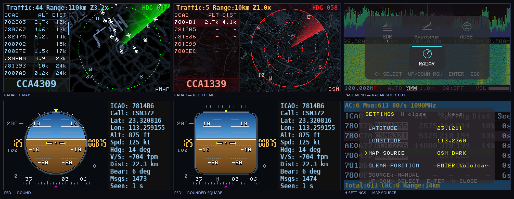
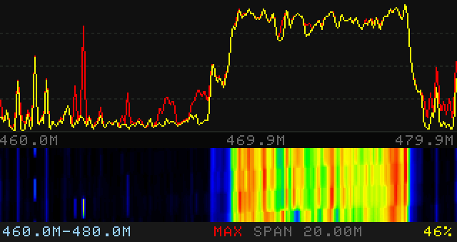

# zeroSDR

[](https://www.gnu.org/licenses/gpl-3.0)
[]()

**简体中文** | [English](README.md)

zeroSDR 是一个面向小屏幕嵌入式 Linux 的开源 SDR 接收程序。频谱和瀑布直接画进
framebuffer，音频解调（FM / NFM / AM / USB / LSB）通过 ALSA 输出，并提供
ADSB、AIS、ACARS 与 RFI 页面。



*ADSB 雷达地图与红色主题、Tab 菜单里的 RADAR 快捷入口、圆球 / 圆角方形 PFD，
以及 `H` 设置里的地图源选择。*

> **在 SDR 页面按 `H` 可以随时显示屏幕按键列表。**
> 在帮助浮层里按 `→` 切到设置页（FM 去加重、音频 AGC、FFT 大小、采样率），
> 再按 `H` 关闭。

| | |
|:---:|:---:|
|  |  |
| 宽带频谱页：460–480 MHz 扫描 + 峰值保持 | SDR 页面：103.6 MHz FM 频谱与瀑布 |

## 功能

- 320×170 framebuffer 上的实时频谱与瀑布
- FM / NFM / AM / USB / LSB 解调，带静噪、音频 AGC、FM 去加重（50/75 µs）
- 硬件 AGC / 手动增益、显示缩放、FFT 大小、采样率预设
- 屏幕按键列表与设置（`H`）；`Tab` 页面菜单带 RADAR 快捷入口
- 宽带扫描频谱页：自定义起止、平移缩放、峰值保持、六种配色
- ADSB 列表按距离排序；长按 `F` 回到顶部
- ADSB 雷达：Esri / 高德 / OSM 地图（高德/OSM 默认暗色）、罗盘航向朝上、
  `R` / `T` 缩放、红色科技主题（`M`）
- ADSB 详情 PFD：圆球 / 圆角方形（`M`）、俯仰梯、坡度指针、
  速度/高度带、音频变音器
- AIS 船舶跟踪：原生双通道解码，LIST / PLOT / DOSSIER / CONSOLE 四种视图，
  地图与 CPA 显示，以及标准 NMEA UDP 输出
- ACARS 航空报文：报文列表与自动换行的详情页；解码器作为独立进程运行，
  频道可按地区配置（默认 131.550 / 131.725 / 131.825）
- RFI 对比：对比业余无线电设备开关前后的 HF 底噪（10m / 20m / 40m / 80m）
- 任意页面 `Fn`+`P` 截图
- 任意页面调节系统音量（`Fn`+`D` / `Fn`+`S`）
- 通过安装包自带的 udev 规则以普通用户运行（不需要 root）
- 针对 Raspberry Pi Zero 2W / Pi 5 与 M5Stack Cardputer Zero 优化

## 硬件要求


*运行 zeroSDR 的 Cardputer Zero（M5Stack CM0）。*

- Raspberry Pi 5 / Pi Zero 2W / M5Stack Cardputer Zero（CM0，aarch64）
- RTL-SDR 电视棒（已验证：RTL-SDR Blog V4，RTL2832U）
- 320×170 framebuffer 屏幕（`/dev/fb0`，Cardputer Zero 上还有 `/dev/fb_lcd`）
- 尽量新的 rtl-sdr 驱动（直接影响调谐准确性）
- 可选：[3D 打印的 RTL-SDR V4 支架](#rtl-sdr-v4-支架)

## RTL-SDR V4 支架

这是作者为 RTL-SDR Blog V4 电视棒设计的 3D 打印支架。它把电视棒固定在
Cardputer Zero 背面，接收机和天线接口可以作为一个整体携带，短 USB-C 线从
电视棒绕回设备。

<a href="hardware/rtl-sdr-v4-mount/CardputerZero_RTLSDR_V4_mount.jpg"></a>

可打印的 STL：
[CardputerZero_RTLSDR_V4_mount.stl](hardware/rtl-sdr-v4-mount/CardputerZero_RTLSDR_V4_mount.stl)，
需要自备 2 颗 M2×6 mm 螺丝（不含），采用
[CC0 1.0](hardware/rtl-sdr-v4-mount/LICENSE) 许可。尺寸和打印说明见
[支架目录](hardware/rtl-sdr-v4-mount/)。

## 快速开始（桌面 / 树莓派）

```bash
sudo apt-get update
sudo apt-get install -y build-essential cmake librtlsdr-dev libasound2-dev libpulse-dev libfreetype-dev nlohmann-json3-dev curl

cmake -S . -B build -DCMAKE_BUILD_TYPE=Release
cmake --build build -j"$(nproc)"

./build/zerosdr                    # 默认：100 MHz、1.024 MS/s、自动增益
./build/zerosdr -f 99300000        # 99.3 MHz FM
./build/zerosdr -s 2048000 -g 20   # 指定采样率和增益
```

在 CM0 上**必须用 Release 构建**：FFT、解调、重采样要在四个小核上实时跑。

## 在 Cardputer Zero 上安装

zeroSDR 已在 Cardputer Zero 应用商店（AppStore）上架：打开商店搜 **zeroSDR**
安装即可。在设备终端等价于：

```bash
sudo apt update && sudo apt install zerosdr
```

包里已经带好程序本体、APPLaunch 入口与图标，以及带 RTL-SDR 后端的
`readsb` 解码器，不需要再装别的东西。

## Cardputer Zero 手动部署

推荐直接安装 AppStore / `.deb` 包。手动安装时用 Release 构建，然后复制程序、
wrapper 和启动文件：

```bash
cmake -S . -B build -DCMAKE_BUILD_TYPE=Release
cmake --build build -j"$(nproc)"
sudo install -Dm755 build/zerosdr /usr/share/APPLaunch/bin/zerosdr
sudo install -Dm755 share/bin/run-zerosdr /usr/share/APPLaunch/bin/run-zerosdr
sudo install -Dm644 share/APPLaunch/applications/zerosdr.desktop \
    /usr/share/APPLaunch/applications/zerosdr.desktop
sudo install -Dm644 share/images/zerosdr.png \
    /usr/share/APPLaunch/share/images/zerosdr.png
systemctl --user restart APPLaunch.service
```

`run-zerosdr` 会选择 LCD framebuffer 和键盘，复用 APPLaunch 的 PipeWire
会话，并把 ES8389 DAC 保持在 -6 dB。运行只需要标准的 librtlsdr udev 规则，
不需要 root；新系统上请先安装该规则，或把用户加入 `plugdev`。

完整部署与恢复说明见 [cardputerzero.md](cardputerzero.md)；构建与打包见
[BUILD.md](BUILD.md)。

构建安装包：

```bash
dpkg-buildpackage -us -uc -b
sudo dpkg -i ../zerosdr_*.deb
```

### 卸载

```bash
sudo rm -f /usr/share/APPLaunch/bin/zerosdr \
           /usr/share/APPLaunch/bin/run-zerosdr \
           /usr/share/APPLaunch/applications/zerosdr.desktop \
           /usr/share/APPLaunch/share/images/zerosdr.png
systemctl --user restart APPLaunch.service
```

## 首次启动

第一次运行会显示一个简短引导（之后可从 `H` → 设置 → `SHOW GUIDE` 重新打开）：

- `H` 打开按键列表与设置
- `Tab` 打开页面菜单，选择 SDR、频谱、ADSB；第二行的 RADAR 快捷入口直接进入 ADSB 雷达视图
- `Enter` 在 ADSB 的 雷达 → 详情 → 列表 之间循环
- `M` 切换 SDR / 雷达配色主题
- 观测点位置：可以手动输入，也可以在检测到 GPS 时自动读取（gpsd 或串口
  NMEA）。手动输入会一直覆盖 GPS，直到在设置里清除位置。编辑器支持负数
  （南纬/西经）：按 `SYM`+`R` 输入减号，再按一次则去掉负号。

## 按键

### 先按 `H`

SDR 页面内置了参考页：

```text
H          打开 / 关闭浮层
← / →      在按键列表和设置页之间切换
↑ / ↓      选择设置项
Enter      修改选中的设置
```

### Cardputer Zero 键位

TCA8418 键盘会自动识别（`tca8418c`）。`F`/`Z`/`X`/`C` 直接作为方向键，`Fn`
组合键发出标准功能码，普通字母键用于 SDR 功能。

| 按键 | 功能 |
|---|---|
| `Z` / `←` | 频率 -step |
| `C` / `→` | 频率 +step |
| `F` / `↑` | 增益 + |
| `X` / `↓` | 增益 - |
| `Alt`+`Z`/`C` | 粗调（step × 10） |
| `0-9` `.` | 直接输入频率（MHz） |
| `Enter` | 应用频率 |
| `Backspace` | 删除一位 |
| `Esc` | 取消输入 |
| `D` | 切换解调模式（FM/NFM/AM/USB/LSB） |
| `B` / `Fn`+`B` | 切换解调带宽 |
| `Fn`+`D` | 音量 +（所有页面可用） |
| `Fn`+`S` | 音量 -（所有页面可用） |
| `S` | 静噪（+5%；长按 >0.5 s = 10%，>1.5 s = 25%） |
| `T` | 切换调谐步进（Auto/100/1k/5k/10k/100k/1M） |
| `Space` / `Fn`+`A` | 音频开关 |
| `G` | 硬件 AGC 开关 |
| `M` | 频谱与瀑布配色主题（DEFAULT/CLASSIC/TURBO/INFERNO/VIRIDIS/PLASMA） |
| `Y` | 显示缩放（只在采样率允许的档位内循环） |
| `Fn`+`P`（F12） | 截图（`~/zerosdr_screenshot_*.png`） |
| `H` | 按键列表，`→` 进设置页 |
| `Tab` | 页面菜单（方向键选择，`Enter` 进入） |
| `Esc`（长按 2 秒） | 退出，屏幕中央有进度提示 |

`Fn`+`D` / `Fn`+`S` 在任何页面都能调节系统音量。launcher 的 labwc 绑定通常
是 5% 一档；如果 300 ms 内系统音量没有变化，zeroSDR 会自己按 10% 调整，
并用 SDR 状态栏或频谱/ADSB 页的 `VOL n%` 提示反馈。SDR 页按音量 + 还会
同时取消静音。

### PC 键盘

| 按键 | 功能 |
|---|---|
| `←` `→` | 调谐（Alt = 粗调）；长按连续步进并加速 |
| `Alt`+`Z`/`C` | 粗调（step × 10） |
| `↑` `↓` | 增益 |
| `D` | 解调模式 |
| `B` / `Shift+B` | 解调带宽 |
| `Space` | 音频开关 |
| `S` | 静噪 |
| `T` | 调谐步进 |
| `M` | 配色主题 |
| `Shift+Z` | 显示缩放 |
| `Shift+R` | FFT 大小 |
| `Shift+S` | 截图 |
| `H` | 按键列表 / 设置 |
| `Tab` | 页面菜单 |
| `Esc`（长按 2 秒） | 退出 |

## 设置页（`H` → `→`）

不常改的选项放在设置页里，不占用快捷键：

| 项目 | 取值 | 默认 |
|---|---|---|
| FM 去加重 | 50 µs（中国/欧洲/亚洲）/ 75 µs（美洲） | 50 µs |
| 音频 AGC | 开 / 关 | 开 |
| FFT 大小 | 256 / 512 / 1024 / 2048 | 512 |
| 采样率 | 1.024 / 1.2 / 1.8 / 2.048 / 2.4 MHz | 1.024 MHz |
| 首次启动引导 | `SHOW GUIDE`：立即重新打开 | — |

修改采样率时，显示跨度会自动切到"新带宽能填满的最大档"（1.2 M → 1.0 M，
2.048 M → 2.0 M），避免出现"跨度大于采样率、按 `Y` 看起来没反应"的情况。

所有设置都在 `~/.config/zerosdr/config.json`。旧的
`sdr_settings.json`、`spectrum_range.txt`、`adsb_config.json` 和
`guide.json` 只会在首次启动时导入一次，之后不再更新。

## 解调带宽预设

**FM（广播）**：200 / 250 / **300** / 400 / 500 kHz
**NFM**：6.25 / **12.5** / 25 kHz
**AM**：5 / **10** / 15 kHz
**SSB（USB/LSB）**：2.4 / 2.7 / 3.0 kHz

## 显示缩放档位

`Y` 循环 50k / 100k / 200k / 500k / 1M / 2M / 2.8M / 3.2M，并且限制在当前
采样率能覆盖的范围内。

## ADSB 页面

按 `Tab` 打开页面菜单（SDR、频谱、ADSB，以及 RADAR 快捷入口）。ADSB 列表按键：

| 按键 | 功能 |
|---|---|
| `↑` / `↓` | 选择飞机 |
| 长按 `F`（上） | 直接回到列表顶部 |
| `←` / `→` | 上下翻 5 行 |
| `Enter` | 顺序切换视图：雷达 → 详情 → 列表 → 雷达 |
| `I` | 切换雷达的 航向朝上 / 北朝上（需要 IMU 罗盘） |
| `0` | 罗盘归零：先把机身上边对准正北，再按一下 |
| `H` | 按键列表 + 设置（经度/纬度、地图源、清除位置） |
| `L` | 设置：观测点位置 + 地图源 |
| `G` / `+` / `-` | 雷达增益模式 / 增益（列表和详情页） |
| `M` | 详情页切换 PFD 形状 / 雷达页切换红色主题 |
| `R` / `T` | 雷达圈缩小 / 放大（雷达视图） |
| `Tab` | 页面菜单 |

列表按距离由近到远排序，没有解出位置的飞机排在最后。雷达左侧列表显示
`ICAO` / 高度 / 距离，选中飞机的呼号以大字显示在左侧栏底部的
暗色通栏条带上（没有呼号时显示 ICAO）。呼号以及 ADSB 的状态栏/详情文字使用抗锯齿
TrueType 字体渲染。

详情页左侧是占满高度的像素风格 PFD（200 px），右侧是 120 px 的飞机文字栏。
没有外框，也没有底部状态栏。大号圆形姿态球占据左侧区域，天空/地面渐变，地平线
随估计的坡度旋转，带俯仰梯和坡度指针；速度/高度刻度在球体两侧，航向带在底部。
速度和高度不用外框，直接在面板上用琥珀色七段数码管显示；高度读数保留前导零，
最后两位是独立滚轮（个位每 1 ft 滚动，十位只在 9→0 进位时转动），每次变化只滚
一下，爬升向上、下降向下。详情页还有音频变音器：只在高度数字滚动时发出密集的
短促点声（每次新数据对应一小段点声），升降越快越密，爬升时音调升高、下降时音调
降低。呼号只在右侧文字栏的 `Call:` 显示，仪表内不重复。
俯仰角由升降率和地速推算，坡度由航向变化率估算。

### 罗盘（BMI270 + BMM150）

部分 Cardputer Zero 主板带有 BMI270 加速度计和 BMM150 磁力计（磁力计挂在 BMI270
的辅助 I²C 总线上）。zeroSDR 通过内核 IIO 的 sysfs 设备读取两个传感器，不需要额外
驱动、守护进程或权限。检测到之后，雷达可以切换为**航向朝上**：罗盘刻度随设备转动，
让机身上边所指的方向始终在圆盘顶部，飞机光点和扫描线也一起转。

- `I` 在 航向朝上 / 北朝上 之间切换。状态栏显示 `HDG 123`：航向朝上时高亮，北朝上
  时变暗（罗盘仍然在跟踪）。
- `0` 把当前方向记为罗盘零点：先把机身上边对准正北（或对准真北，把当地磁偏角一并
  吃掉），再按一下。偏移会写入配置文件。
- 航向优先使用 BMI270 陀螺仪（投影到重力方向，机身倾斜时也能正确取偏航角），
  磁力计只做低速修正。磁力计只有在场强接近地磁（约 0.2–1.2 高斯）时才可信；
  这块板子的 BMM150 离扬声器磁铁太近，实测场强有几个高斯，转动时几乎不变。
- 磁力计受干扰时由陀螺仪负责航向；按 `0` 把当前方向对齐到正北。
  `imu.invert` 可以翻转旋转方向。
- 没有 IMU 的机型，雷达保持北朝上，按 `I` 只会响一声提示。

设置保存在 `~/.config/zerosdr/config.json`：

```json
"imu": {
  "enabled": true,
  "heading_up": true,
  "offset_deg": 0.0,
  "invert": false
}
```

`offset_deg` 用来补偿芯片在机身里的安装角度（也可以吸收磁偏角）；`invert` 用于
镜像安装时翻转旋转方向。

### 雷达地图背景

雷达可以下载一块低精度地图，作为雷达背景。默认铺满整个屏幕，左侧列表和顶部状态栏
会略微透明叠在地图之上。地图是可选的，会缓存，下载在后台线程里进行；网络慢或没有
网络不会卡住雷达。

默认使用 **Esri World Dark Gray Base**：深色、无地名标签、不需要 API key。其他
`map.provider`：

| provider | 说明 |
|---|---|
| `esri_dark` | 默认。无需 key，无标签，显示海岸线/河流/陆地。 |
| `esri_imagery` | 卫星影像。无需 key，但细节较杂。 |
| `osm` | OSM 标准瓦片，默认显示为 `OSM DARK`。 |
| `amap` | 高德瓦片，WGS-84 会转换为 GCJ-02。 |
| `carto_dark_nolabels` | CARTO 现在对无 key 请求加 “API KEY REQUIRED” 水印，仅建议配合带 key 的自定义 URL。 |
| `custom` | 使用 `map.url_template`，支持 `{z}`、`{x}`、`{y}`。 |

- `L`（或 `H` → 设置）里可以切换地图源；在 `Map source` 上按 Enter 会循环
  `ESRI DARK -> AMAP -> OSM -> ESRI DARK`，并立即保存
- 默认下载 5×5 张瓦片，裁成以观测点为中心的 1024×1024 图块，足够铺满整个屏幕；
  设 `full_screen=false` 则回到 3×3 / 512×512、只画在雷达圆内的旧模式。图块缓存到
  `~/.cache/zerosdr/radar_map/`
- `dim` 是地图叠在雷达深色背景上的不透明度（0.1–1.0）。Esri 深色底图会做一次
  中间调提亮，保证海岸线和河流在小屏上仍然看得清
- `dark`（可选）会把浅色地图反色、去色并染成暗蓝灰；`amap` 和 `osm` 默认是
  `true`，所以设置里显示为 `AMAP DARK` / `OSM DARK`；Esri 深色底图默认关闭。
  把 `"dark": false` 可以恢复原来的浅色样式
- `proxy` 可以填标准代理 URL，例如 `socks5h://192.168.31.59:1082`；留空表示直连
  或继承 `https_proxy` 环境变量
- 下载使用系统 `curl`，因此软件包依赖 `curl`
- 署名以小字显示在雷达右下角；Esri、OSM、高德的数据各有自己的署名和使用条款
- 下载失败时继续使用旧图或纯黑背景；失败的地图 key 会退避 60 秒再试
- CARTO 的公开瓦片现在需要 API key，无 key 会得到水印图；无 key 的国际默认源请用
  `esri_dark`

观测点位置可以来自 GPS（gpsd 的 2947 端口，或 `/dev/serial0`、`/dev/ttyAMA0`、
`/dev/ttyS0`、`/dev/ttyUSB0`、`/dev/ttyACM0` 上的 NMEA 数据）。会记住最后一次
定位；手动输入的位置优先，直到清除为止；ADSB 设置页会显示当前来源是
GPS / MANUAL / SAVED / NOT SET。

ADSB 解码使用随包安装的 `readsb`（带 RTL-SDR 后端，位于
`/usr/lib/zerosdr/readsb`），不需要另外安装解码器；如果系统里有
`/usr/bin/readsb` 则作为后备。

按 `H` 打开全屏浮层，两个标签页：按键列表和设置页。设置页可以查看/修改观测点
经纬度（回车进入原来的位置编辑界面），也可以清除已保存的位置。`←`/`→` 切换
标签页，`↑`/`↓` 选择，`Enter` 编辑，`H` 关闭。编辑器里按 `SYM`+`R` 输入减号
（再按一次去掉负号），南纬/西经和正坐标一样输入。

音效反馈：

- 列表光标移动时短促“嘀”一声
- 雷达每转一圈（60°/s，6 秒）一次声纳 ping
- 扫描线每经过 90° 一个轻微 tick
- 出现新飞机时两音提示（最多每 3 秒一次）

## 宽带频谱页

`Tab` 打开页面菜单（SDR / 频谱 / ADSB，第二行还有 RADAR 快捷入口）。频谱页是一个 qspectrumanalyzer 风格的
扫描式频谱仪：把 RTL-SDR 在用户指定的起止频率之间反复调谐，把每一片拼成一条宽
频谱，下面配瀑布。RTL-SDR V4 的范围是 24–1766 MHz。

第一次进入时会要求输入 START / STOP（MHz）。用数字和 `.` 输入，`↑`/`↓` 切换字段，
`Enter` 逐项确认；范围保存在 `~/.config/zerosdr/config.json` 的 `spectrum` 段里，
之后直接复用。

| 按键 | 功能 |
|---|---|
| `←` / `→` | 平移可见窗口 |
| `↑` / `↓` 或 `+` / `-` | 放大 / 缩小 |
| `Enter` | 回到完整范围 |
| `M` | 峰值保持开关（红色包络，按 1.5 dB/s 回落） |
| `Space` | 显示平滑开关（约 1 MHz 中值滤波） |
| `R` | 修改起止频率 |
| `H` | 半透明帮助浮层 |
| `Tab` | 页面菜单（方向键选择，`Enter` 进入） |
| `Esc`（长按 2 秒） | 退出 |

说明：

- 每一片用 1.024 MHz 采样率、取中间约 0.78 MHz，调谐稳定 15 ms，一步约 20 ms；
  20 MHz 范围不到一秒扫完，100 MHz 几秒钟。
- 宽频时一个 bin 约 2 kHz，放大后一个 bin 一列像素。
- 宽带频谱页固定使用 tuner 自动增益（AGC）。手动增益会放大 RTL-SDR 的
  28.8 MHz 时钟泄漏，所以这里不提供；需要手动增益请到 SDR 页调。
- `Space` 切换显示平滑：对画出来的轨迹做约 1 MHz 的中值滤波，再和原始轨迹
  按 50/50 混合（半强度）。它能压掉窄的时钟 spur、让宽信号显出来，同时保留
  一部分真实的窄信号。采集的 bin、峰值保持和回落都不受影响，只过滤显示轨迹和
  新写入的瀑布行；开启时状态栏显示 `SM`。
- 峰值保持默认开启，`M` 关闭时会清空已记录的峰值。红色包络按 1.5 dB/s 回落
  （`spectrum.max_hold_decay_db_s`，设为 0 则永久保持），已经消失的峰会自动退掉，
  持续存在的信号仍会每轮刷新自己的电平。
- 平移或缩放时会清空瀑布窗口，避免显示别处残留的历史。
- 离开页面时会释放 SDR，交还给 SDR 页和 ADSB 页。

## 命令行参数

```text
Usage: zerosdr [options]
  -f <freq>     中心频率（Hz，默认 100000000）
  -s <rate>     采样率（Hz，默认 1024000）
  -g <gain>     增益（dB，默认自动）
  -d <device>   framebuffer 设备（默认 /dev/fb0）
  -k <device>   键盘输入设备（默认自动检测）
  -h            显示帮助
```

## 常见问题

### 瀑布看起来是空的，但声音很清晰

FM 广播对轻微偏调不敏感：电台偏离显示中心 100 kHz 时声音依然清楚，只是峰值会
落在红色中心线的左/右一点。想让它居中，就调到峰上（FM AUTO 步进刚好 100 kHz）。

正中那条很窄的亮线是 RTL-SDR 的 **DC / 本振泄漏**，不是电台；真正的广播电台是
约 200 kHz 宽的平台。

### 空频率上声音很响

静噪关闭（`SQ:OFF`）+ 音频 AGC 打开时，解调噪声会被放大到接近满幅。按 `S`
把静噪加上，噪声就会被门限挡掉。

### 找不到 RTL-SDR / 权限不足

```bash
lsusb | grep -i 0bda
ls -l /dev/bus/usb/*/*      # 应为 root:plugdev 0660
groups pi                   # 应含 plugdev、video、audio、input
```

安装/升级 `librtlsdr0` 后重新插拔电视棒。

### 设备忙

```bash
sudo pkill readsb
sudo pkill -f rtl_
```

### 没有声音

```bash
aplay -L | head             # "default" 应指向 PipeWire
amixer -c 1 sget Speaker
```

精简系统里可能没有 ALSA 的 `default` 路由（日志会显示
`Cannot open audio device default`）。程序会自动回退到 `pulse` / `pipewire` /
声卡设备；如果都没有，安装 `libasound2-plugins`：

```bash
sudo apt-get install -y libasound2-plugins
```

wrapper 会把 `DACL/DACR Playback Volume` 设为 179（-6 dB）；0 dB 时 ES8389
功放会断音。

### 频偏

```bash
rtl_test -p                 # 测量 PPM
```

几 ppm 属正常（例如 -27 ppm ≈ 100 MHz 上 2.7 kHz）。偏得很多通常是 rtl-sdr
驱动太旧。

### 黑屏 / 画到别的屏幕

```bash
cat /proc/fb
ls -l /dev/fb*
```

手动运行排除 APPLaunch 因素：

```bash
/usr/share/APPLaunch/bin/zerosdr -d /dev/fb_lcd \
    -k /dev/input/by-path/platform-3f804000.i2c-event
```

## 交叉编译

```bash
sudo apt-get install -y gcc-aarch64-linux-gnu g++-aarch64-linux-gnu libfreetype-dev

cmake -S . -B build-aarch64 -DCMAKE_BUILD_TYPE=Release \
  -DCMAKE_SYSTEM_NAME=Linux \
  -DCMAKE_SYSTEM_PROCESSOR=aarch64 \
  -DCMAKE_C_COMPILER=aarch64-linux-gnu-gcc \
  -DCMAKE_CXX_COMPILER=aarch64-linux-gnu-g++
cmake --build build-aarch64 -j"$(nproc)"

scp build-aarch64/zerosdr pi@<cardputer-ip>:/tmp/
```

## 许可证

本项目采用 GNU General Public License v3.0，详见 [LICENSE](LICENSE)。

[`hardware/rtl-sdr-v4-mount/`](hardware/rtl-sdr-v4-mount/) 下的 RTL-SDR V4
支架文件单独采用 CC0 1.0 许可，不受应用代码的 GPLv3 影响。

## 致谢

- 基于 [rtl-sdr](https://github.com/osmocom/rtl-sdr)
- 面向 M5Stack Cardputer Zero 设计
