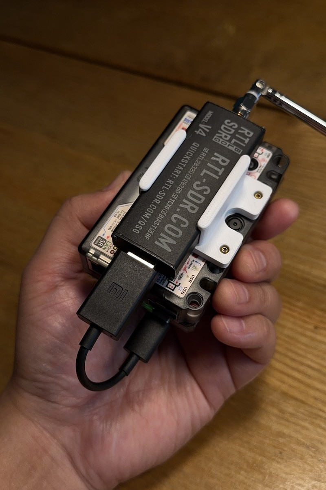

# Cardputer Zero RTL-SDR V4 mount

A 3D-printed bracket that clamps an RTL-SDR Blog V4 dongle to the back of the
M5Stack Cardputer Zero. The dongle lies parallel to the case and a short USB-C
cable loops from the dongle back to the device.

Designed by Weiming Feng, the ZeroSDR author.

## Files

| File | Description |
| --- | --- |
| `CardputerZero_RTLSDR_V4_mount.stl` | Printable model, exported in millimetres. The mesh keeps its CAD coordinates (offset about 2500 x 1470 mm from the origin), so use "center on bed" or move it to the origin in the slicer. |
| `CardputerZero_RTLSDR_V4_mount.jpg` | Photo of the mount in use. |

## Hardware

- Two M2 x 6 mm screws (not included).

## Printing

- Bounding box: about 39 x 43 x 19 mm.
- Check the clip overhangs in the slicer preview; depending on the orientation
  you choose they may need supports.
- PLA and PETG both work. The photo shows a white print.

## License

The STL and the photo in this directory are released under
[CC0 1.0 Universal](LICENSE) (public domain dedication): copy, modify, print
and sell prints without attribution.
